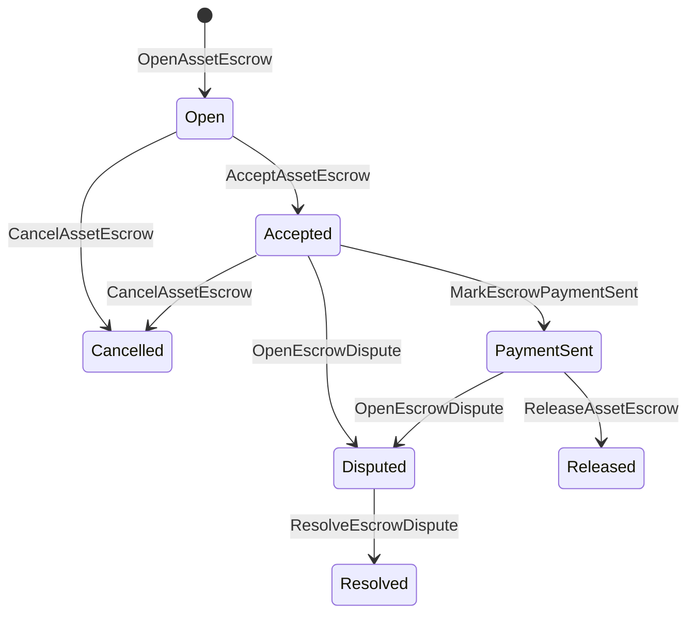

# Բնական ակտիվների վարկավճար {#native-asset-escrow}

Native escrow- ը թվային ակտիվների պահեստավորման մեխանիզմ է, որը կառավարվում է գլխավոր գրասենյակում: Փոխարենը ակտիվները ուղարկելու համար հավելվածի սեփական հաշվին եւ դիմման կոդի վրա հիմնվելով այդ հաշիվը պաշտպանելու համար, escrow ISIs փոխանցում է արժեքը դետերմինիստական արձանագրության պահպանումի հաշիվ եւ գրանցում է escrow կյանքի ցիկլը համաշխարհային վիճակում:

Օգտագործեք բնիկ էսկրոուն շուկայական հաշվարկների, Aitai ոճի արտաշղթայական վճարումների համակարգման, փուլային արգելափակումների և հավաստողին կապված այնպիսի պայմանական ազատումների համար, որոնց կյանքի ցիկլի վիճակը պետք է տեսանելի լինի մատյանում։

## Գլխավոր գաղափարներ {#concepts}

|Գլխավոր |Նկարագրություն |
| --- | --- |
|`EscrowId` |Կանչողի ընտրած նույնացուցիչ, որը փաթաթում է հեշ։ Այն պետք է եզակի լինի էսկրոուի բոլոր գրառումների միջև։ |
|`AssetEscrowRecord` |Թվային ակտիվների թափանցիկ պահպանումը կամ փակումը: |
|Պահպանության հաշիվ |Դիտերմինիստական արձանագրության հաշիվ, որը ստացվել է շղթայից ID, պահպանումից ID եւ ակտիվի սահմանումից: |
|Բացադրիչներ |Բացադրիչները կարող են բացահայտել հաշիվներ, դատավճիռներ, հաղորդագրություններ, պահեստային մանիֆեսներ կամ այլ ապացույցներ դուրս շղթայից: Ապացույցների օգտակար բեռնվածքը չի պահվում գրասենյակում:|

Անցանցիկ արձանագրությունները պարունակում են վաճառողին, ընտրական գնորդին, ակտիվների սահմանումը, ընդհանուր գումարը, պահպանումի հաշիվը, կյանքի շրջանի կարգավիճակը, վարքագծի տեսակը, մնացած գումարը, ընտրական թողարկման լիազորությունը, ընտրական ժամկետն ավարտելու ժամանակային նշանը, ապացույցների շիշերը, ժամանակային նշակները եւ ընտրական լուծումների մանրամասները:

Պահպանման գումարը պետք է լինի դրական թվային ակտիվների քանակությունը եւ պետք է համապատասխանի ակտիվի սահմանման թվային բնութագրին: Քանի դեռ պահպանման կամ փակման գործողություն կա, ընդհանուր ակտիվների փոխանցումները չեն կարող սպառել պահպանումի հաշիվը. պահպանումից դուրս գալու ուղիները ստորեւ նկարագրված են ISIs։

## Շուկայի պահպանումը {#marketplace-escrow}

Շուկայի պահպանումները համակարգում են շղթայական ակտիվների թողարկումը եւ արտաքին վճարման կամ առաքման աշխատանքային հոսքը:



|ISI |Ո՞վ է ներկայացնում այն:|Արդյունք |
| --- | --- | --- |
|`OpenAssetEscrow` |Վաճառող |Փակվում է վաճառողի թվային ակտիվը արձանագրության պահեստում եւ ստեղծվում `Open` շուկայական ռեկորդ: |
|`AcceptAssetEscrow` |Գնորդ |Գնորդը գրանցում է եւ փոխանցում `Open` դեպի `Accepted`. Վաճառողը չի կարող ընդունել իր սեփական գրավականը: |
|`MarkEscrowPaymentSent` |Ընդունված գնորդ |Տեղափոխվում է `Accepted` դեպի `PaymentSent` այն բանից հետո, երբ գնորդը ուղարկում է վճարումը դուրս շղթայից: |
|`ReleaseAssetEscrow` |Վաճառող |Տեղափոխում է `PaymentSent` դեպի `Released` եւ փոխանցում ամբողջ գրավված գումարը գնորդին: |
|`CancelAssetEscrow` |Վաճառող |Տեղափոխում է `Open` կամ `Accepted` դեպի `Cancelled` եւ փոխհատուցում վաճառողին մինչեւ վճարման նշումը: |
|`OpenEscrowDispute` |Վաճառող կամ ընդունված գնորդ |Տեղափոխում է `Accepted` կամ `PaymentSent` դեպի `Disputed` եւ հավելում ապացույցների շիշներ: |
|`ResolveEscrowDispute` |Հաշիվ `CanResolveEscrowDispute` |Տեղափոխում է `Disputed` դեպի `Resolved` եւ բաժանում գումարը գնորդի եւ վաճառողի միջեւ: |

Վեճերի լուծման գումարը պետք է ոչ բացասական լինի, եւ `buyer_amount + seller_amount` պետք է հավասար լինի պահպանումի գումարի: Թույլատրվում են զրոյական արժեք ունեցող հատված, բայց ամբողջ բաժանումը պետք է հաշվի առնի փակված հաշվառումը:

### Rust Օրինակ {#rust-example}

Այս օրինակը ենթադրում է, որ վաճառողի եւ գնորդի հաշիվները արդեն գոյություն ունեն, ակտիվների սահմանումը գրանցվում է որպես թվային, եւ վաճառողը ունի բավարար մնացորդ:

```rust
use iroha::{
    client::Client,
    data_model::{
        isi::escrow::{
            AcceptAssetEscrow, MarkEscrowPaymentSent, OpenAssetEscrow,
            ReleaseAssetEscrow,
        },
        prelude::*,
    },
};
use iroha_crypto::Hash;

fn release_marketplace_escrow(
    seller_client: &Client,
    buyer_client: &Client,
    asset_definition_id: AssetDefinitionId,
) -> eyre::Result<()> {
    let escrow_id = EscrowId::new(Hash::new("docs-marketplace-escrow-001"));

    seller_client.submit_blocking(OpenAssetEscrow::with_evidence_hashes(
        escrow_id,
        asset_definition_id,
        Numeric::from(40_u64),
        vec![Hash::new("invoice:2026-001")],
    ))?;

    buyer_client.submit_blocking(AcceptAssetEscrow::new(escrow_id))?;
    buyer_client.submit_blocking(MarkEscrowPaymentSent::new(escrow_id))?;
    seller_client.submit_blocking(ReleaseAssetEscrow::new(escrow_id))?;

    let record = seller_client.query_single(FindAssetEscrowById::new(escrow_id))?;
    assert_eq!(record.status, AssetEscrowStatus::Released);
    assert_eq!(record.remaining_amount, Numeric::zero());

    Ok(())
}
```

## Գնացական ակտիվների կոճակները {#generic-asset-locks}

Ակտիվի արգելափակման համար օգտագործվում է պահառության նույն տեսակի գրառումը։ Սա գնորդի և վաճառողի միջև առաջարկ չէ։ Միջոցներն արգելափակվում են նպատակային հաշվի օգտին, և դրանք ստանալու համար կարող է պահանջվել առանձին իրավասու կողմի թույլտվությունը։

|ISI |Ո՞վ է ներկայացնում այն:|Արդյունք |
| --- | --- | --- |
|`OpenAssetLock` |Աղբյուրի հաշիվ|Բացառիկ գումարը փակվում է, գրանցում է նպատակակետը որպես ռեկորդային գնորդ եւ կարգավորում `Locked`: |
|`DrawdownAssetLock` |Ազատացման լիազորություն կամ նպատակակետ, երբ ոչ մի ազատման լիազորությունը չի սահմանվել |Մնացած պահապանների մի մասը կամ ամբողջությունը տեղափոխում է նպատակակետ: |
|`CancelAssetLock` |Կոշտացման բացիչը|Անջատում է ակտիվ փակումը եւ վերադարձնում է մնացած գումարը բացողին: |
|`ExpireAssetLock` |Ցանկացած գործարքի լիազոր հաշիվ ժամկետից հետո |Անցյալում `expires_at_ms` հետ փակված բանալին ավարտվում է եւ մնացած գումարը վերադարձվում է բացողին: |

`DrawdownAssetLock` պահում է արձանագրությունը `Locked`, մինչդեռ որոշակի գումարը մնում է: Երբ մնացած գումարը հասնում է զրոյին, կարգավիճակը դառնում է `DrawnDown` եւ արձանագրությունն փակվում է:

```rust
use iroha::{
    client::Client,
    data_model::{
        isi::escrow::{CancelAssetLock, DrawdownAssetLock, ExpireAssetLock, OpenAssetLock},
        prelude::*,
    },
};
use iroha_crypto::Hash;

fn drawdown_and_close_asset_locks(
    opener_client: &Client,
    destination_client: &Client,
    release_authority_client: &Client,
    asset_definition_id: AssetDefinitionId,
    destination: AccountId,
    release_authority: AccountId,
) -> eyre::Result<()> {
    let trusted_lock_id = EscrowId::new(Hash::new("docs-asset-lock-trusted"));

    opener_client.submit_blocking(OpenAssetLock::with_options(
        trusted_lock_id,
        asset_definition_id.clone(),
        destination.clone(),
        Numeric::from(40_u64),
        Some(release_authority),
        None,
        vec![Hash::new("milestone-plan-v1")],
    ))?;

    release_authority_client.submit_blocking(DrawdownAssetLock::new(
        trusted_lock_id,
        Numeric::from(15_u64),
    ))?;

    let partially_drawn =
        opener_client.query_single(FindAssetEscrowById::new(trusted_lock_id))?;
    assert_eq!(partially_drawn.status, AssetEscrowStatus::Locked);
    assert_eq!(partially_drawn.remaining_amount, Numeric::from(25_u64));

    opener_client.submit_blocking(CancelAssetLock::new(trusted_lock_id))?;
    let cancelled = opener_client.query_single(FindAssetEscrowById::new(trusted_lock_id))?;
    assert_eq!(cancelled.status, AssetEscrowStatus::Cancelled);

    let expiring_lock_id = EscrowId::new(Hash::new("docs-asset-lock-expiring"));
    opener_client.submit_blocking(OpenAssetLock::with_options(
        expiring_lock_id,
        asset_definition_id,
        destination,
        Numeric::from(10_u64),
        None,
        Some(0),
        Vec::new(),
    ))?;

    destination_client.submit_blocking(ExpireAssetLock::new(expiring_lock_id))?;
    let expired = opener_client.query_single(FindAssetEscrowById::new(expiring_lock_id))?;
    assert_eq!(expired.status, AssetEscrowStatus::Expired);

    Ok(())
}
```

Python-ը ներկայումս տրամադրում է բարձր մակարդակի օգնականներ ընդհանուր արգելափակումների համար՝ `open_asset_lock`, `drawdown_asset_lock`, `cancel_asset_lock` և `expire_asset_lock`։ Python-ից շուկայական և պայմանական էսկրոուի համար օգտագործեք կանոնական `InstructionBox` JSON՝ SDK-ի JSON-ի ուղղակի մուտքի միջոցով, կամ ներկայացրեք գործարքը այնպիսի SDK-ի միջոցով, որը տրամադրում է էսկրոուի լիարժեք կառուցիչներ։

## Վեճեր {#disputes}

Շուկայի պահպանումը կարող է վեճ մուտք գործել `Accepted` կամ `PaymentSent`: Միայն գրանցված վաճառողը կամ գնորդը կարող է բացել վեճը: Որոշումը պահանջում է `CanResolveEscrowDispute`, որը կամ ուղղակիորեն տրվում է լուծողի հաշիվին կամ ժառանգվում է դերի միջոցով:

```rust
use iroha::{
    client::Client,
    data_model::{
        isi::escrow::{OpenEscrowDispute, ResolveEscrowDispute},
        prelude::*,
    },
};
use iroha_crypto::Hash;
use iroha_executor_data_model::permission::escrow::CanResolveEscrowDispute;

fn resolve_disputed_escrow(
    admin_client: &Client,
    buyer_client: &Client,
    court_client: &Client,
    court: AccountId,
    escrow_id: EscrowId,
) -> eyre::Result<()> {
    admin_client.submit_blocking(Grant::account_permission(
        Permission::from(CanResolveEscrowDispute),
        court,
    ))?;

    buyer_client.submit_blocking(OpenEscrowDispute::with_evidence_hashes(
        escrow_id,
        vec![Hash::new("buyer-payment-receipt")],
    ))?;

    court_client.submit_blocking(ResolveEscrowDispute::with_evidence_hashes(
        escrow_id,
        Numeric::from(30_u64),
        Numeric::from(10_u64),
        vec![Hash::new("court-judgement-001")],
    ))?;

    let record = admin_client.query_single(FindAssetEscrowById::new(escrow_id))?;
    assert_eq!(record.status, AssetEscrowStatus::Resolved);
    assert_eq!(
        record.resolution.as_ref().map(|resolution| resolution.buyer_amount.clone()),
        Some(Numeric::from(30_u64)),
    );

    Ok(())
}
```

## Պայմանական էսկրոու {#conditional-escrow}

Պայմանական էսկրոուն արգելափակում է թվային ակտիվը շահառուի համար և այն ազատում է միայն այն բանից հետո, երբ բոլոր պայմանները հերթականությամբ բավարարվում են։ Յուրաքանչյուր պայման նշում է հավաստողի հաշիվը, մատյանի կողմից գնահատվող պրեդիկատը (`Equals` տիպավորված արժեքին կամ `QuantityAtMost` սահմանին) և իր՝ մեկից սկսվող հերթական համարը։ Մատյանի ժամանակի ընտրովի պատուհանը սահմանափակում է բոլոր հավաստումները։

| ISI | Կանչող | Ազդեցություն |
| --- | --- | --- |
| `OpenConditionalEscrow` | Բացող | Գումարն արգելափակում է արձանագրության պահառության ներքո՝ անփոփոխ պայմաններով և ժամկետի բացարձակ ավարտով։ |
| `AttestEscrowCondition` | Պայմանի հավաստողը | Հաջորդ պայմանի համար տրամադրում է `Bool`, `Text` կամ `Quantity` արժեք։ Երբ վերջին պայմանը բավարարվում է, էսկրոուն ազատվում է հօգուտ շահառուի։ |
| `ExpireConditionalEscrow` | Ցանկացած հաշիվ | Ժամկետի ավարտից հետո գումարը վերադարձնում է բացողին, եթե էսկրոուն չի ազատվել։ |

## SDK Օգտագործում {#sdk-usage}

Էսկրոուի աջակցությունը տարբեր SDKs-ում տարբեր կերպ է տրամադրվում։ Rust-ն ունի կանոնական տիպավորված տվյալների մոդել։ Python-ը ներկայումս տրամադրում է ակտիվների ընդհանուր արգելափակման օգնականներ։ JavaScript-ը և TypeScript-ը օգտագործում են Kotodama-ի էսկրոուի հոսթ կանչեր։ Kotlin/JVM-ը և Swift-ը տրամադրում են տիպավորված օգտակար բեռի կառուցիչներ շուկայական էսկրոուի համար։

|SDK |Օգտագործեք այս մակերեսը:|Հասարակություն |
| --- | --- | --- |
| [Rust](#rust-sdk) |`iroha::data_model::isi::escrow` |Շուկայական էսկրոու, ընդհանուր արգելափակումներ, պայմանական էսկրոու, հարցումներ և իրադարձություններ։ |
| [Python](#python-asset-locks) |`Instruction.open_asset_lock`, `TransactionDraft.open_asset_lock` և հաճախորդի `*_and_wait` օգնականներ |Ակտիվների ընդհանուր արգելափակումներ։ Շուկայական և պայմանական էսկրոուի օգնականները դեռ Python-ի լիարժեք մեթոդներ չեն։ |
| [JavaScript / TypeScript](#javascript-and-typescript-kotodama) |`compileKotodamaProgram`ից `@iroha/iroha-js/kotodama-compiler` |Kotodama պայմանագրերի ներսում պահպանումների հյուրընկալող զանգեր: |
| [Kotlin / JVM](#kotlin-and-jvm) |`InstructionTemplate` դասերը `org.hyperledger.iroha.sdk.core.model.instructions`-ում |Շուկայական էսկրոուի հատուկ հրահանգների ձևանմուշներ։ |
| [Swift / iOS](#swift-and-ios) |`NativeEscrowInstructionBuilders` և `IrohaSDK.build*Escrow*` օգնականներ |Շուկայական էսկրոուի Norito JSON հրահանգների օգտակար բեռներ։ |

Ստորեւ բերված օրինակները կենտրոնանում են հրահանգների կառուցման վրա: Հաշվի ֆինանսավորումը, ստորագրությունների կառավարումը եւ գործարքի ներկայացումը հետեւում են յուրաքանչյուրի համար սովորական հոսքին SDK.

### Rust SDK {#rust-sdk}

Օգտագործեք Rust SDK-ն, երբ ձեզ անհրաժեշտ է լիարժեք բնիկ ծածկույթ կամ հարցումների/իրադարձությունների աջակցություն։ Վերևի օրինակները ցույց են տալիս շուկայական էսկրոուի ազատումը, ընդհանուր արգելափակումից միջոցների դուրսբերումը և վեճի լուծումը `iroha::data_model::isi::escrow`-ի միջոցով։

```rust
use iroha::{
    client::Client,
    data_model::{isi::escrow::OpenAssetEscrow, prelude::*},
};
use iroha_crypto::Hash;

fn open_and_read(
    client: &Client,
    asset_definition_id: AssetDefinitionId,
) -> eyre::Result<AssetEscrowRecord> {
    let escrow_id = EscrowId::new(Hash::new("docs-rust-sdk-escrow"));

    client.submit_blocking(OpenAssetEscrow::new(
        escrow_id,
        asset_definition_id,
        Numeric::from(10_u64),
    ))?;

    client.query_single(FindAssetEscrowById::new(escrow_id))
}
```

### Ակտիվների արգելափակումը Python-ով {#python-asset-locks}

Python SDK-ը բացահայտում է առաջին դասի օգնականները գեներիկ ակտիվների փակման համար: Օգտագործեք դրանք կարեւորագույն վճարումների, ազատագրման մարմնի կողմից դուրսբերումների, բացողի կողմից չեղարկման եւ ժամկետով վերադարձերի համար:

```python
client.open_asset_lock_and_wait(
    chain_id="dev-chain",
    authority="<source-account-id>",
    private_key_hex="<source-private-key-hex>",
    escrow_id="merchant-lock-001",
    asset_definition_id="<asset-definition-base58>",
    destination="<destination-account-id>",
    amount="2500",
    release_authority="<trusted-release-account-id>",
    expires_at_ms=1_704_000_000_000,
)

client.drawdown_asset_lock_and_wait(
    chain_id="dev-chain",
    authority="<trusted-release-account-id>",
    private_key_hex="<trusted-release-private-key-hex>",
    escrow_id="merchant-lock-001",
    amount="1000",
)

client.expire_asset_lock_and_wait(
    chain_id="dev-chain",
    authority="<any-account-id>",
    private_key_hex="<any-private-key-hex>",
    escrow_id="merchant-lock-001",
)
```

Երկու կողմի փակման դեպքում բաց թողնել `release_authority`; ապա նպատակային հաշիվը կարող է ներկայացնել `drawdown_asset_lock`.

### JavaScript եւ TypeScript Kotodama {#javascript-and-typescript-kotodama}

JavaScript SDK-ը ներկայումս չի տրամադրում ներկառուցված էսկրոու գործարքների անմիջական կառուցիչներ։ Kotodama պայմանագրեր տեղակայող JavaScript կամ TypeScript ծրագրերի համար էսկրոուի հոսթային կանչերը կազմեք Kotodama կոմպիլյատորով։

Native escrow հյուրընկալող զանգերը պահանջում են բացասական մուտքի ակնարկներ, քանի որ կոմպիլյատորը չի կարող ստանալ ոչ թափանցիկ escrow ISIs համար ավելի նեղ մուտքի հավաքածուներ: Օգտագործեք արտահանված մուտքային կետերի վրա վայլդքարտի ակնարկեր, որոնք կանչում են `escrow_*` կառուցվածքներ:

```js
import { compileKotodamaProgram } from "@iroha/iroha-js/kotodama-compiler";

const source = `
seiyaku MarketplaceEscrow {
  meta { abi_version: 1; }

  #[access(read="*", write="*")]
  kotoage fn run() permission(Admin) {
    let asset = asset_definition("62Fk4FPcMuLvW5QjDGNF2a4jAmjM");
    let offer = name("aitai_offer");
    let evidence = norito_bytes("00");

    call escrow_open_offer(offer, asset, 10, evidence);
    call escrow_accept(offer);
    call escrow_mark_payment_sent(offer);
    call escrow_release(offer);
  }
}
`;

const compiled = compileKotodamaProgram(source, {
  sourceName: "escrow.ko",
});

if (compiled.diagnostics.length > 0) {
  throw new Error(compiled.diagnostics.map((item) => item.message).join("\n"));
}
```

Վեճերի համար օգտագործեք `escrow_open_dispute(offer, evidence)` և `escrow_resolve_dispute(offer, buyer_amount, seller_amount, evidence)`։

### Kotlin եւ JVM {#kotlin-and-jvm}

Kotlin/JVM SDK մոդելները ներկառուցված պահպանում որպես հարմարեցված հրահանգների ձեւանմուշներ: Յուրաքանչյուր ձեւանմունք հաստատում է պահանջվող դաշտերը եւ բացահայտում է գործարքի ստեղծողի կողմից օգտագործվող կանոնական փաստարկների քարտեզը:

```kotlin
import org.hyperledger.iroha.sdk.core.model.escrow.NativeEscrowPermissions
import org.hyperledger.iroha.sdk.core.model.instructions.AcceptAssetEscrowInstruction
import org.hyperledger.iroha.sdk.core.model.instructions.MarkEscrowPaymentSentInstruction
import org.hyperledger.iroha.sdk.core.model.instructions.OpenAssetEscrowInstruction
import org.hyperledger.iroha.sdk.core.model.instructions.ReleaseAssetEscrowInstruction
import org.hyperledger.iroha.sdk.core.model.instructions.ResolveEscrowDisputeInstruction

val open = OpenAssetEscrowInstruction(
    escrowId = "escrow-hash",
    assetDefinition = "xor#wonderland",
    amount = "42.5",
    evidenceHashes = listOf("invoice-hash"),
)
val accept = AcceptAssetEscrowInstruction("escrow-hash")
val paid = MarkEscrowPaymentSentInstruction("escrow-hash")
val release = ReleaseAssetEscrowInstruction("escrow-hash")
val resolve = ResolveEscrowDisputeInstruction(
    escrowId = "escrow-hash",
    buyerAmount = "30",
    sellerAmount = "12.5",
    evidenceHashes = listOf("judgement-hash"),
)

println(open.arguments)
println(NativeEscrowPermissions.CAN_RESOLVE_ESCROW_DISPUTE)
```

### Swift եւ iOS {#swift-and-ios}

Swift SDK կառուցում է գրավման հրահանգները որպես Norito JSON օգտակար բեռնվածքներ: Օգտագործեք `NativeEscrowInstructionBuilders` անմիջապես կամ զանգահարեք հավասար `IrohaSDK.build*Escrow*` օգնականը, երբ ձեր ծրագիրը արդեն ունի `IrohaSDK` օրինակ:

```swift
import IrohaSwift

let open = try NativeEscrowInstructionBuilders.openAssetEscrow(
    escrowId: "escrow-hash",
    assetDefinition: "xor#wonderland",
    amount: "42.5",
    evidenceHashes: ["invoice-hash"]
)
let accept = try NativeEscrowInstructionBuilders.acceptAssetEscrow(
    escrowId: "escrow-hash"
)
let paid = try NativeEscrowInstructionBuilders.markEscrowPaymentSent(
    escrowId: "escrow-hash"
)
let release = try NativeEscrowInstructionBuilders.releaseAssetEscrow(
    escrowId: "escrow-hash"
)
let resolve = try NativeEscrowInstructionBuilders.resolveEscrowDispute(
    escrowId: "escrow-hash",
    buyerAmount: "30",
    sellerAmount: "12.5",
    evidenceHashes: ["judgement-hash"]
)
```

Վեճը լուծողի թույլտվության տոկենը հասանելի է որպես `NativeEscrowPermissions.canResolveEscrowDispute`։

## Հարցումներ եւ իրադարձություններ {#queries-and-events}

Օգտագործեք էսկրոուի հարցումները վիճակի էջերի, հաշտեցման աշխատանքների և աջակցության գործիքների համար։

|Հարցում |Նպատակ |
| --- | --- |
|`FindAssetEscrowById` |Կարդացեք մեկ թափանցիկ պահապան կամ փակեք `EscrowId`. |
|`FindAssetEscrows` |Թողարկեք թափանցիկ պահեստային եւ փակման գրառումները: |
|`FindAssetEscrowsBySeller` |Թողարկեք վաճառողի կամ բանտի բացողի կողմից բացված գրառումները: |
|`FindAssetEscrowsByBuyer` |Ցուցադրել գնորդի կողմից ընդունված շուկայական պահուստները կամ փակել նպատակակետին ուղղված բանալիները: |
|`FindAssetEscrowsByStatus` |`AssetEscrowStatus` հաշվետվությունների ցուցակը: |

`EscrowEventFilter`-ը կարող է բաժանորդագրվել թափանցիկ բնիկ էսկրոուի և արգելափակումների իրադարձություններին՝ ըստ էսկրոուի ID-ի, վաճառողի, գնորդի, կարգավիճակի և իրադարձությունների հավաքածուի դիմակի։ Իրադարձությունների ընտանիքը ներառում է `Opened`, `Accepted`, `PaymentSent`, `Released`, `Cancelled`, `Expired`, `Disputed` և `Resolved` իրադարձությունները։

## Գործառական գրառումներ {#operational-notes}

- Պահեք խոշոր հաշիվներ, զրուցային օրագրեր, դատավճիռներ կամ աուդիտների փաթեթներ պահեք վարկային գրառումներից դուրս եւ դրանց հետ միացրեք որպես ապացույց:
- Օգտագործեք հավելվածներում կայուն `EscrowId` ծագումը, այնպես որ կրկնակի փորձերը չեն կարող ստեղծել նույն առաջարկի համար կրկնօրինակ երաշխիքներ:
- Հատկացում `CanResolveEscrowDispute` միայն վեճի ընթացակարգն իրականացնող հաշիվների կամ դերի համար:
- Պահանջվում է հաշվի առնել վճարումների վավերացումը, որը կատարվում է ոչ թե շղթայից դուրս: Iroha արձանագրում է պահպանումների եւ կյանքի շրջանի անցումները. այն ինքնուրույն չի ստուգում ֆիատային կամ արտաքին վճարման ուղիները:
