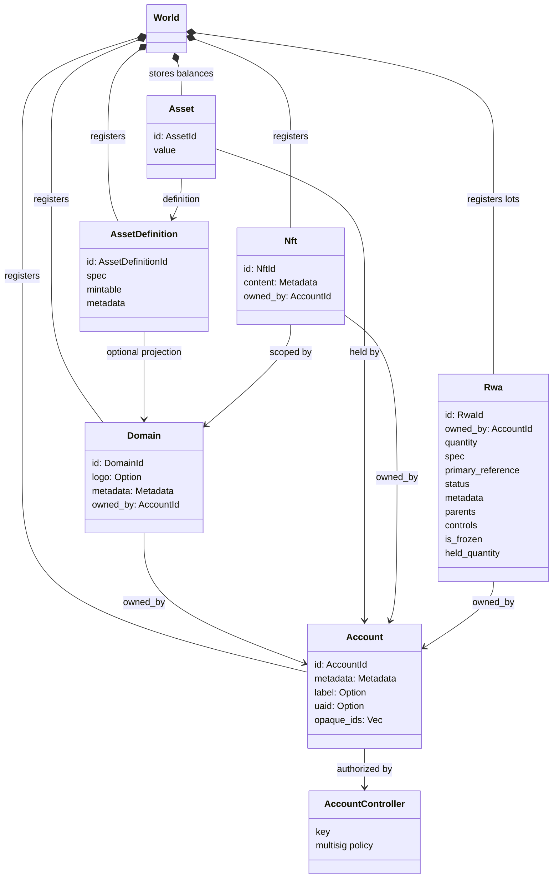
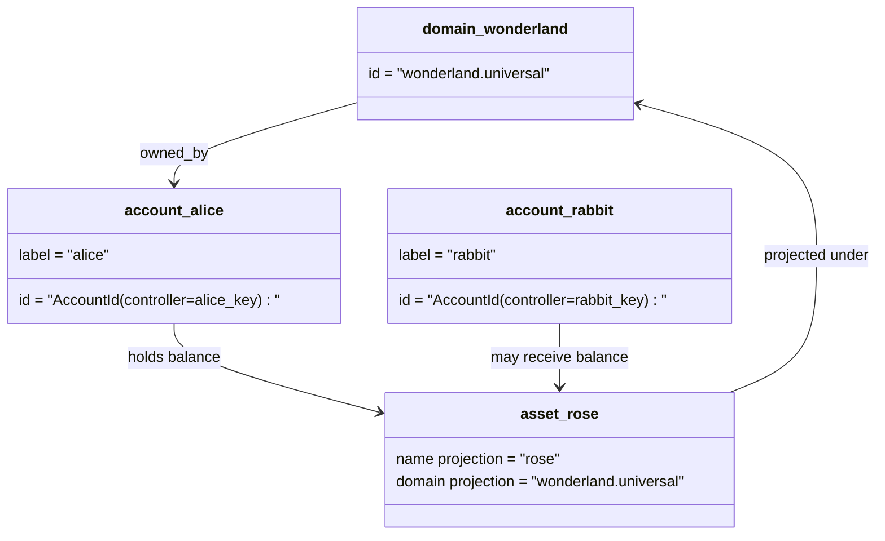

# ဒေတာပုံစံ {#data-model}

Iroha သည် blockchain ledger အခြေအနေကို `World` တွင် သိမ်းဆည်းထားသည်။ ၎င်း၏ပထမဦးဆုံးထုတ်ပြန်မှုဒေတာပုံစံသည် အောက်ပါ တစ်ခုတည်းသော ပရိုတိုကောစံညွှန်းအမည်များနှင့်အဖွဲ့အစည်းများကိုအသုံးပြုသည်:

- ဒေတာနေရာအရည်အချင်းရှိသော ဒိုမီနိုင်းများ၊ ဥပမာ `payments.universal`
- အကောင့်များမှာ Single Protocol Standard နှင့် Domainless ရှိပြီး Account ID ကို Account Controller မှ ရယူထားသည်။
- အရင်းအမြစ်အဓိပ္ပါယ်ဖွင့်ဆိုချက်တွေဟာ ဒိုမင်/နာမည် စီမံကိန်းကို ထိန်းသိမ်းနိုင်ပေမဲ့ ၎င်းတို့ရဲ့ တစ်ခုတည်းသော ပရိုတိုကုတ်စံညွှန်း စာသားလိပ်စာက မရှင်းလင်းတဲ့ Base58 မှတ်သားရေးကိရိယာပါ။
- အရင်းအမြစ်ဆိုသည်မှာ သီးခြားအရင်းအမြစ်သတ်မှတ်ချက်အတွက်စာရင်းများမှ သိမ်းဆည်းထားသော ငွေကြေးကျန်ရစ်မှုဖြစ်ပါသည်။
- NFTs သည် domain-qualified IDs နှင့် metadata content များနှင့်အတူ သီးသန့်ပိုင်ဆိုင်သော မှတ်တမ်းများဖြစ်သည်။
- RWAs သည် လက်ရှိပိုင်ရှင်၊ အရေအတွက်၊ မူလနေရာ၊ မီတာဒေတာ၊ သိမ်းဆည်းမှု၊ အေးဆေးခြင်းနှင့် သက်တမ်းပတ်ဝန်းကျင် ထိန်းချုပ်ချက်များရှိသော ချိတ်ဆက်မှုအပြင် ပိုင်ဆိုင်မှုများကို ကိုယ်စားပြုသည့် ထုတ် generated-ID များဖြစ်သည်။

## နမူနာ {#example}

Iroha 3 ကွန်ရက်တစ်ခုတွင် `wonderland.universal` သည် `universal` data space အတွင်းရှိ domain ဖြစ်သည်။ ဤဥပမာရှိ စံအကောင့်များကို ၎င်းတို့၏ ကီးများ သို့မဟုတ် မူဝါဒများက ထိန်းချုပ်ပြီး domain မပါသော I105 အကောင့် ID များအဖြစ် encode လုပ်ထားသည်။ `alice@wonderland.universal` ကဲ့သို့ ဖတ်ရှုရလွယ်သော အမည်များသည် ထို ID များနှင့် ချိတ်ထားသော သီးခြား alias များဖြစ်သည်။ `wonderland.universal` အတွင်းရှိ `rose` ကဲ့သို့ domain နှင့် အမည်ကို သုံး၍ ပိုင်ဆိုင်မှုသတ်မှတ်ချက်၏ ကိုယ်စားပြုပုံကို ဆက်လက်တည်ဆောက်နိုင်သော်လည်း ကွန်ရက်ပို့ဆောင်မှုပုံစံတွင် သုံးသော စံပိုင်ဆိုင်မှုသတ်မှတ်ချက် လိပ်စာမှာ ထုတ်လုပ်ရရှိသော Base58 လိပ်စာဖြစ်သည်။

## Alias များ {#aliases}

Alias များသည် လယ်ဂျာ၏ စံသတ်မှတ်နံပါတ်များအပေါ် ထပ်ဆင့်ပေးထားသည့် လူဖတ်ရလွယ်သော အမည်များဖြစ်သည်။ API၊ CLI၊ ပိုက်ဆံအိတ်နှင့် explorer နယ်နိမိတ်များတွင် အသုံးဝင်သော်လည်း တင်းကျပ်သော လယ်ဂျာအကွက်များတွင် သိမ်းထားသည့် စံသတ်မှတ်နံပါတ်များကသာ တည်ငြိမ်သော အထောက်အထားများဖြစ်သည်။

|ရည်မှန်းချက်|တစ်ခုတည်းသော ပရိုတိုကုတ်စံညွှန်း ရည်မှန်းချက် |Alias စာလုံးအရ |နောက်ခံပုံစံ |
| -------------- | --------------------------------------------------- | ------------------------------------------------------ | ----------------------------------------------------------------------------- |
|အသုံးပြုသူစာရင်း |domainless `AccountId` ကို I105 လိပ်စာအဖြစ် ကုဒ်သွင်းထား |`name@domain.dataspace` သို့မဟုတ် `name@dataspace` |`AccountAlias`; အဓိက အမည်စာရင်းက `Account.label` ဖြစ်ပြီး ထပ်မံအမည်စာရင်းတွေက ချည်နှောင်မှုပါ။ |
|အရင်းအမြစ် သတ်မှတ်ချက် |Single protocol-standard `AssetDefinitionId` Base58 အမည် |`name#domain.dataspace` သို့မဟုတ် `name#dataspace` |`AssetDefinitionAlias` အရင်းအမြစ် သတ်မှတ်ချက်နှင့် ချည်နှောင်နေသည် |
|စာချုပ် |Single protocol-standard Bech32m `ContractAddress` |`name::domain.dataspace` သို့မဟုတ် `name::dataspace` |`ContractAlias` စေလွှတ်ထားတဲ့ စာချုပ်လိပ်စာနဲ့ ချည်နှောင်ထားတယ်။ |
|ဒိုမင်နာမည် |`DomainId` ကို `domain.dataspace` ပုံစံမှာ |`domain.dataspace` |SNS `domain` နာမည်နေရာ မှတ်တမ်း |
|ဒေတာနေရာအမည် |Active Nexus စာရင်းထဲက နံပါတ် `DataSpaceId` |`universal`, `paynet`, (သို့) `zk` လို ဒေတာနေရာအမည်များ|SNS `dataspace` နာမည်နေရာ မှတ်တမ်းပေါင်းပြီး တက်ကြွတဲ့ ဒေတာနေရာ စာရင်း |

Account aliases တွေဟာ user-facing account နာမည်တွေပါ။ alias world-state index များနှင့် account rekey မှတ်တမ်းများမှတဆင့် တက်ကြွသော အကောင့် ID ကိုမှတ်ချက်ပေးသည်။ `SetPrimaryAccountAlias` အကောင့်ရဲ့ အဓိက တံဆိပ်အတွက်၊ `SetAccountAliasBinding` နောက်ထပ် အဓိကမဟုတ်တဲ့ အမည်အမည်များအတွက်၊ `FindAccountByAlias` ဒါမှမဟုတ် `FindAliasesByAccountId` Account aliases တွေအတွက် ပုံမှန်အားဖြင့် Active ကို လိုအပ်ပါတယ်။ SNS ငွေပေးချေမှုအစီအစဉ် `AcquireAccountAliasLease` ပြန်လည်ပြုပြင်ခြင်း `RenewAccountAliasLease`.

ပိုင်ဆိုင်မှု alias များသည် အကောင့်တစ်ခုချင်းစီ၏ လက်ကျန်ပမာဏကို အမည်ပေးခြင်းမဟုတ်ဘဲ ပိုင်ဆိုင်မှုသတ်မှတ်ချက်များကို အမည်ပေးသည်။ ပိုင်ဆိုင်မှု alias နှင့် contract alias တို့သည် ဖတ်ရှုရလွယ်သော အမည်မှ ရှိနှင့်ပြီးသော စံပစ်မှတ်သို့ တိုက်ရိုက်ချိတ်ဆက်မှုများဖြစ်သည်။ ပိုင်ဆိုင်မှု alias များကို `SetAssetDefinitionAlias` ဖြင့် သတ်မှတ်သည်။ Alias ၏ အမည်အပိုင်းသည် ပိုင်ဆိုင်မှုသတ်မှတ်ချက်၏ ပြသအမည် သို့မဟုတ် ကိုယ်စားပြုသတ်မှတ်ချက်အမည်နှင့် ကိုက်ညီရမည်။ Contract alias များကို `SetContractAlias` ဖြင့် သတ်မှတ်သည်။ Alias ၏ data space သည် contract လိပ်စာတွင် encode လုပ်ထားသော data space နှင့် ကိုက်ညီရမည်။ ချိတ်ဆက်မှုနှစ်မျိုးလုံး၌ `lease_expiry_ms` ပါဝင်နိုင်သည်။ သက်တမ်းကုန်ပြီးနောက် ဆိုင်းငံ့ကာလပါ ကုန်ဆုံးသည့်အခါ ၎င်းတို့ကို ဖြေရှင်းရှာဖွေ၍ မရတော့ဘဲ ကမ္ဘာလုံးဆိုင်ရာ အခြေအနေအညွှန်းများမှ ရှင်းလင်းဖယ်ရှားသည်။

Domain တွေမှာ သီးခြား `DomainAlias` ပိုင်ဆိုင်မှုမရှိဘူး။ domain ID ဟာ `payments.universal` လို ဒေတာနေရာအတွက် အရည်အချင်းရှိတဲ့ နာမည်တစ်ခုပါ။ SNS သည်ငှားရမ်းပိုင်ခွင့်ကို ခြေရာခံတယ်။ `domain` နာမည်နေရာအတွင်းက ဒိုမင်အမည်များအတွက်နှင့် `dataspace` နာမည်နေရာတွင်ရှိသော ဒေတာနေရာ အမည်မဲ့အမည်များ အတွက်။ ကန့်သတ်ထားသော `universal` ဒေတာနေရာအမည်မဲ့အနက်များသည် သတ်မှတ်ထားရမည်ဖြစ်သည်။

## ဆက်စပ်သော စာတမ်းများ {#related-docs}

|အကြောင်းအရာ|ဘယ်ကိုသွားရမလဲ|
| -------------------------------------- | ------------------------------------------- |
|ဒိုမင်များ|[ဒိုမင်များ](/my/blockchain/domains.md) |
|အကောင့်များ |[အကောင့်များ](/my/blockchain/accounts.md) |
|အရင်းအမြစ်များ|[ပိုက်ဆံများ](/my/blockchain/assets.md) |
|NFTs |[NFTs](/my/blockchain/nfts.md) |
|လက်တွေ့ကမ္ဘာက ပိုင်ဆိုင်မှု |[လက်တွေ့လောကဆိုင်ရာ အရင်းအမြစ်များ](/my/blockchain/rwas.md) |
|မီတာဒေတာ|[မီတာဒေတာ](/my/blockchain/metadata.md) |
|မှတ်ပုံတင်ခြင်းနှင့် လွှဲပြောင်းခြင်းဆိုင်ရာ ညွှန်ကြားချက်များ |[ညွှန်ကြားချက်](/my/blockchain/instructions.md) |
|ဆော့ဝဲ အကောင်အထည်ဖော်ရေး ပတ်ဝန်းကျင် ခွင့်ပြုချက်များ |[ခွင့်ပြုချက်များ](/my/blockchain/permissions.md) |
|နာမည်ပေးခြင်း စည်းမျဉ်းများ |[အမည်ပေးခြင်းဆိုင်ရာ စည်းမျဉ်းများ](/my/reference/naming.md) |
