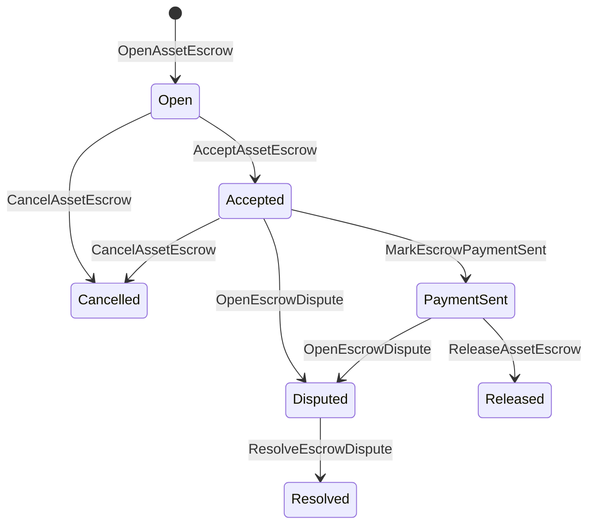

# ပိုင်ဆိုင်မှုများကို စံညွှန်ကြားချက်ဖြင့် ကြားခံထိန်းသိမ်းခြင်း {#native-asset-escrow}

Native escrow ဆိုသည်မှာ ကိန်းဂဏန်းဆိုင်ရာ အရင်းအမြစ်များအတွက် blockchain ledger ထိန်းသိမ်းမှု ယန္တရားမှ စီမံခန့်ခွဲထားသော Native Escrow ဖြစ်သည်။ အဆိုပါစာရင်းကိုကာကွယ်ရန် လျှောက်လွှာကုဒ်၊ အချုပ်အခြာခံ ISIs တန်ဖိုးကို သတ်မှတ်ချက်ဆိုင်ရာ ပရိုတိုကောလစ် ထိန်းသိမ်းရေးစာရင်းသို့ပြောင်းပြီး ကမ္ဘာ့အခြေအနေတွင် အချုပ်အခမဲ့သက်တမ်းလည်ပတ်မှုကို မှတ်တမ်းတင်ပါ။

စျေးကွက်ဆိုင်ရာ ငွေစာရင်းရှင်းလင်းမှု၊ Aitai ပုံစံ off-chain ငွေပေးချေမှု ညှိနှိုင်းမှု၊ မှတ်တိုင်အလိုက် lock များနှင့် လယ်ဂျာပေါ်တွင် မြင်နိုင်သော သက်တမ်းစက်ဝန်းအခြေအနေ လိုအပ်သည့် သက်သေခံအတည်ပြုသူနှင့် ချိတ်ဆက်ထားသော အခြေအနေအလိုက် ထုတ်ပေးမှုများအတွက် မူလပံ့ပိုးထားသော escrow ကို အသုံးပြုပါ။

## အယူအဆများ {#concepts}

|အယူအဆ|သရုပ်ဖော်ချက် |
| --- | --- |
| `EscrowId` | ခေါ်ဆိုသူက ရွေးချယ်ထားပြီး hash တစ်ခုကို ထုပ်ပိုးထားသော သတ်မှတ်အမှတ်အသား။ ၎င်းသည် escrow မှတ်တမ်းအားလုံးအကြား တစ်ခုတည်းသာ ဖြစ်ရမည်။ |
|`AssetEscrowRecord` |ပွင့်လင်းမြင်သာတဲ့ ကိန်းဂဏန်းအရ အရင်းအမြစ် ဂိုဏ်း (သို့) Lock မှတ်တမ်း။ |
|စောင့်ရှောက်မှုစာရင်း |Chain ID၊ escrow ID နဲ့ Asset Definition တွေကနေ ရယူထားတဲ့ Deterministic Protocol account ပါ။ |
|သက်သေခံ cryptographic hashes များ |Evidence cryptographic hashes တွေက ငွေကြေးခွန်တွေ၊ ဆုံးဖြတ်ချက်တွေ၊ သတင်းစကားတွေ၊ သိုလှောင်တဲ့ နည်းပညာ မန်နေဖစ်တွေ (သို့) အခြားအချိတ်ဆက်မထားတဲ့ အထောက်အထားတွေကို ဖော်ထုတ်နိုင်ပါတယ်။ သက်သေပြမှု အသုံးဝင်မှုကိုယ်၌ကို escrow မှတ်တမ်းမှာ သိမ်းဆည်းခြင်းမရှိဘူး။ |

ပွင့်လင်းမြင်သာသော မှတ်တမ်းများတွင် ရောင်းသူ၊ ရွေးချယ်သုံးစွဲသူ၊ အရင်းအမြစ် သတ်မှတ်ချက်၊ စုစုပေါင်းပမာဏ၊ ထိန်းသိမ်းစာရင်း၊ သက်တမ်း စက်ဝန်းအခြေအနေ၊ အပြုအမူအမျိုးအစား၊ ကျန်ငွေကြေး၊ ရွေးချယ်ထုတ်ပြန်ခွင့်ပြုမှု မူဝါဒ၊ ရွေးချယ်သက်တမ်းကုန်ဆုံးသည့် အချိန်တံဆိပ်၊ သက်သေခံ cryptographic hashes များ၊ အချိန်တံဆစ်များနှင့် ရွေးချယ်ဖြေရှင်းရေး အသေးစိတ်များပါဝင်သည်။

Escrow ပမာဏတွေဟာ အပြုသဘော ကိန်းဂဏန်း အရင်းအမြစ်အရေအတွက်တွေ ဖြစ်ပြီး asset အဓိပ္ပါယ်ဖွင့်ဆိုချက်ရဲ့ ကိန်း ဂဏန်း သတ်မှတ်ချက်နဲ့ ကိုက်ညီဖို့လိုပါတယ်။ escrow (သို့) lock က တက်ကြွနေတုန်းမှာ ယေဘုယျအရင်းအမြစ် လွှဲပြောင်းမှုက custody account ကို မဖြုတ်နိုင်ပါဘူး။ custody exit paths တွေက အောက်မှာဖော်ပြထားတဲ့ escrow ISIs ဖြစ်ပါတယ်။

## စျေးကွက် Escrow {#marketplace-escrow}

Marketplace escrow ဟာ ချိတ်ဆက်ထားတဲ့ အရင်းအမြစ်တွေကို ချိတ်ဆက်တဲ့ ချိတ်ဆက်မှုထဲက ငွေပေးချေမှု (သို့) ပို့ဆောင်ရေး လုပ်ငန်းခွင်နဲ့ ညှိနှိုင်းပါတယ်။



|ISI |ဘယ်သူက တင်ပြတာလဲ။|သက်ရောက်မှု |
| --- | --- | --- |
|`OpenAssetEscrow` |ရောင်းသူ |ရောင်းသူရဲ့ ကိန်းဂဏန်းအရင်းအမြစ်ကို ပရိုတိုကောလစ် ထိန်းသိမ်းမှုမှာ ချိတ်ထားပြီး `Open` စျေးကွက်မှတ်တမ်းတစ်ခု ဖန်တီးတယ်။ |
|`AcceptAssetEscrow` |ဝယ်သူ |ဝယ်သူကို မှတ်တမ်းတင်ပြီး `Open` ကို `Accepted` သို့ ရွှေ့ပြောင်းတယ်။ ရောင်းသူက သူ့ကိုယ်ပိုင် အာမခံကို လက်ခံလို့မရဘူး။ |
|`MarkEscrowPaymentSent` |လက်ခံထားရသူ |`Accepted` ကို `PaymentSent` သို့ပြောင်းသည် ဝယ်ယူသူက ကွင်းဆက်ပြင်ပ ငွေပေးချေမှုပို့ပြီးနောက်။ |
|`ReleaseAssetEscrow` |ရောင်းသူ |`PaymentSent` ကို `Released` သို့ ရွှေ့ပေးပြီး အပြည့်အဝ ကမ်းလှမ်းထားသော ပမာဏကို ဝယ်ယူသူအား လွှဲပြောင်းပေးသည်။ |
|`CancelAssetEscrow` |ရောင်းသူ |`Open` (သို့) `Accepted` ကို `Cancelled` သို့ပြောင်းပြီး ငွေပေးချေမှု အမှတ်တံဆိပ်မပါမီ ရောင်းသူအား ပြန်လည်ပေးသွင်းသည်။ |
|`OpenEscrowDispute` |ရောင်းသူ (သို့) လက်ခံဝယ်ယူသူ |`Accepted` (သို့) `PaymentSent` ကို `Disputed` သို့ပြောင်းပြီး အထောက်အထားအတွက် cryptographic hash များကိုထည့်သွင်းသည်။ |
|`ResolveEscrowDispute` |`CanResolveEscrowDispute` နှင့်စာရင်း|`Disputed` ကို `Resolved` သို့ပြောင်းပြီး ဝယ်သူနဲ့ရောင်းသူကြားမှာ ပမာဏကိုခွဲတယ်။ |

အငြင်းပွားမှုဖြေရှင်းရေး ပမာဏများသည် အပျက်သဘောမဟုတ်ဘဲ `buyer_amount + seller_amount` သည် ဂိုဒေါင်ငွေပမာဏနှင့်ညီရမည်။ သုညတန်ဖိုးရှိ ငွေကြေးလွှဲပြောင်းမှုအစိတ်အပိုင်းများကို ခွင့်ပြုထားသော်လည်း ခွဲဝေမှုတစ်ခုလုံးက ပိတ်ထားသော ဆန်လန်ကို ထည့်တွက်ရသည်။

### Rust ဥပမာ {#rust-example}

ဒီဥပမာက ရောင်းသူနဲ့ ဝယ်သူရဲ့ အကောင့်တွေ ရှိပြီးသား၊ အရင်းအမြစ် အဓိပ္ပါယ်ဖွင့်ဆိုချက်ကို ကိန်းဂဏန်းအဖြစ် မှတ်ပုံတင်ထားပြီး ရောင်းသူမှာ လုံလောက်တဲ့ ဟန်ချက်ရှိတယ်လို့ ယူဆတယ်။

```rust
use iroha::{
    client::Client,
    data_model::{
        isi::escrow::{
            AcceptAssetEscrow, MarkEscrowPaymentSent, OpenAssetEscrow,
            ReleaseAssetEscrow,
        },
        prelude::*,
    },
};
use iroha_crypto::Hash;

fn release_marketplace_escrow(
    seller_client: &Client,
    buyer_client: &Client,
    asset_definition_id: AssetDefinitionId,
) -> eyre::Result<()> {
    let escrow_id = EscrowId::new(Hash::new("docs-marketplace-escrow-001"));

    seller_client.submit_blocking(OpenAssetEscrow::with_evidence_hashes(
        escrow_id,
        asset_definition_id,
        Numeric::from(40_u64),
        vec![Hash::new("invoice:2026-001")],
    ))?;

    buyer_client.submit_blocking(AcceptAssetEscrow::new(escrow_id))?;
    buyer_client.submit_blocking(MarkEscrowPaymentSent::new(escrow_id))?;
    seller_client.submit_blocking(ReleaseAssetEscrow::new(escrow_id))?;

    let record = seller_client.query_single(FindAssetEscrowById::new(escrow_id))?;
    assert_eq!(record.status, AssetEscrowStatus::Released);
    assert_eq!(record.remaining_amount, Numeric::zero());

    Ok(())
}
```

## ယေဘုယျ အရင်းအမြစ် Lock များ {#generic-asset-locks}

Asset locks တွေမှာ custody record အမျိုးအစားတစ်ခုတည်းကိုသုံးပေမဲ့ ဝယ်သူနဲ့ရောင်းသူ ကမ်းလှမ်းမှုမဟုတ်ပါဘူး။ ဒါတွေဟာ ရည်ရွယ်ချက်စာရင်းအတွက် ငွေကြေးကိုပိတ်ထားပြီး ရွေးချယ်စရာအနေနဲ့ ငွေကြေးထုတ်ယူဖို့ သီးခြားလွတ်မြောက်ခွင့်လိုင်စင် လိုအပ်ပါတယ်။

|ISI |ဘယ်သူက တင်ပြတာလဲ။|သက်ရောက်မှု |
| --- | --- | --- |
|`OpenAssetLock` |အရင်းအမြစ်စာရင်း|အပြုသဘောဆောင်တဲ့ ပမာဏကို ပိတ်ထားပြီး မှတ်တမ်းဝယ်သူအဖြစ် ရည်ရွယ်ချက်မှတ်တမ်းတင်ထားပြီး အခြေအနေကို `Locked` သို့ သတ်မှတ်တယ်။ |
|`DrawdownAssetLock` |လွတ်မြောက်ခွင့်ပြုမှု မူလစာရင်း (သို့) လွှတ်ထွက်ခွင့်ပြုမှုမူလစာရင်း မသတ်မှတ်ပါက ရည်ရွယ်ချက် |ကျန်ရှိနေသေးတဲ့ ထိန်းသိမ်းမှုကို တစ်စိတ်တစ်ပိုင်း (သို့) အပြည့်အဝ ရည်မှန်းချက်နေရာကို လွှဲပြောင်းတယ်။ |
|`CancelAssetLock` |Lock opener ကို|Active lock ကို ဖျက်ပြီး ကျန်တဲ့ပမာဏကို ဖွင့်သူဆီ ပြန်ပေးပါတယ်။ |
| `ExpireAssetLock` | သတ်မှတ်နောက်ဆုံးအချိန် ကျော်ပြီးနောက် မည်သည့် transaction authority အကောင့်မဆို | `expires_at_ms` က အတိတ်အချိန် ဖြစ်နေသော lock ကို သက်တမ်းကုန်စေပြီး ကျန်ပမာဏကို ဖွင့်ခဲ့သူထံ ပြန်အမ်းသည်။ |

`DrawdownAssetLock` သည် `Locked` တွင် မှတ်တမ်းကို ထိန်းသိမ်းထားပြီး တစ်ချို့ပမာဏများ ကျန်ရှိနေသည်။ ကျန်သောပမာဏက သုညသို့ရောက်တဲ့အခါ အခြေအနေသည် `DrawnDown` ဖြစ်လာပြီး မှတ်တမ်းကို ပိတ်ထားသည်။

```rust
use iroha::{
    client::Client,
    data_model::{
        isi::escrow::{CancelAssetLock, DrawdownAssetLock, ExpireAssetLock, OpenAssetLock},
        prelude::*,
    },
};
use iroha_crypto::Hash;

fn drawdown_and_close_asset_locks(
    opener_client: &Client,
    destination_client: &Client,
    release_authority_client: &Client,
    asset_definition_id: AssetDefinitionId,
    destination: AccountId,
    release_authority: AccountId,
) -> eyre::Result<()> {
    let trusted_lock_id = EscrowId::new(Hash::new("docs-asset-lock-trusted"));

    opener_client.submit_blocking(OpenAssetLock::with_options(
        trusted_lock_id,
        asset_definition_id.clone(),
        destination.clone(),
        Numeric::from(40_u64),
        Some(release_authority),
        None,
        vec![Hash::new("milestone-plan-v1")],
    ))?;

    release_authority_client.submit_blocking(DrawdownAssetLock::new(
        trusted_lock_id,
        Numeric::from(15_u64),
    ))?;

    let partially_drawn =
        opener_client.query_single(FindAssetEscrowById::new(trusted_lock_id))?;
    assert_eq!(partially_drawn.status, AssetEscrowStatus::Locked);
    assert_eq!(partially_drawn.remaining_amount, Numeric::from(25_u64));

    opener_client.submit_blocking(CancelAssetLock::new(trusted_lock_id))?;
    let cancelled = opener_client.query_single(FindAssetEscrowById::new(trusted_lock_id))?;
    assert_eq!(cancelled.status, AssetEscrowStatus::Cancelled);

    let expiring_lock_id = EscrowId::new(Hash::new("docs-asset-lock-expiring"));
    opener_client.submit_blocking(OpenAssetLock::with_options(
        expiring_lock_id,
        asset_definition_id,
        destination,
        Numeric::from(10_u64),
        None,
        Some(0),
        Vec::new(),
    ))?;

    destination_client.submit_blocking(ExpireAssetLock::new(expiring_lock_id))?;
    let expired = opener_client.query_single(FindAssetEscrowById::new(expiring_lock_id))?;
    assert_eq!(expired.status, AssetEscrowStatus::Expired);

    Ok(())
}
```

Python သည် လက်ရှိတွင် ယေဘုယျ lock များအတွက် အဆင့်မြင့် အကူအညီပေး function များဖြစ်သော `open_asset_lock`၊ `drawdown_asset_lock`၊ `cancel_asset_lock` နှင့် `expire_asset_lock` ကို ပံ့ပိုးပေးသည်။ Python မှ စျေးကွက် escrow နှင့် အခြေအနေအလိုက် escrow အတွက် SDK ၏ JSON ဖြင့် တိုက်ရိုက်ထည့်သွင်းနိုင်သည့် နည်းလမ်း (escape hatch) မှတဆင့် စံ `InstructionBox` JSON ကို အသုံးပြုပါ၊ သို့မဟုတ် ပထမတန်းစား escrow builder များကို ပံ့ပိုးပေးသော SDK မှတဆင့် တင်သွင်းပါ။

## အငြင်းပွားမှု {#disputes}

`Accepted` သို့မဟုတ် `PaymentSent` မှ စျေးကွက်အမှတ်တံဆိပ်တစ်ခုက ပဋိပက္ခကိုဝင်ရောက်နိုင်သည်။ မှတ်ပုံတင်ရောင်းသူ (သို့) ဝယ်သူသာပဋိပက္ခဖွင့်နိုင်သည်။ ဖြေရှင်းရန်အတွက် `CanResolveEscrowDispute` ကိုလိုအပ်သည်၊ အဖြေရှာသူစာရင်းသို့ တိုက်ရိုက်ပေးအပ်ထားသည် သို့မဟုတ် အခန်းကဏ္ဍမှတစ်ဆင့် အမွေခံရသည်။

```rust
use iroha::{
    client::Client,
    data_model::{
        isi::escrow::{OpenEscrowDispute, ResolveEscrowDispute},
        prelude::*,
    },
};
use iroha_crypto::Hash;
use iroha_executor_data_model::permission::escrow::CanResolveEscrowDispute;

fn resolve_disputed_escrow(
    admin_client: &Client,
    buyer_client: &Client,
    court_client: &Client,
    court: AccountId,
    escrow_id: EscrowId,
) -> eyre::Result<()> {
    admin_client.submit_blocking(Grant::account_permission(
        Permission::from(CanResolveEscrowDispute),
        court,
    ))?;

    buyer_client.submit_blocking(OpenEscrowDispute::with_evidence_hashes(
        escrow_id,
        vec![Hash::new("buyer-payment-receipt")],
    ))?;

    court_client.submit_blocking(ResolveEscrowDispute::with_evidence_hashes(
        escrow_id,
        Numeric::from(30_u64),
        Numeric::from(10_u64),
        vec![Hash::new("court-judgement-001")],
    ))?;

    let record = admin_client.query_single(FindAssetEscrowById::new(escrow_id))?;
    assert_eq!(record.status, AssetEscrowStatus::Resolved);
    assert_eq!(
        record.resolution.as_ref().map(|resolution| resolution.buyer_amount.clone()),
        Some(Numeric::from(30_u64)),
    );

    Ok(())
}
```

## အခြေအနေအလိုက် Escrow {#conditional-escrow}

အခြေအနေအလိုက် escrow သည် ကိန်းဂဏန်းပိုင်ဆိုင်မှုတစ်ခုကို အကျိုးခံစားခွင့်ရှိသူအတွက် lock လုပ်ထားပြီး အခြေအနေတိုင်းကို အစဉ်လိုက် ကျော်ဖြတ်ပြီးမှသာ ထုတ်ပေးသည်။ အခြေအနေတစ်ခုစီတွင် သက်သေခံအတည်ပြုသူ၏ အကောင့်၊ လယ်ဂျာက အကဲဖြတ်သော စစ်ဆေးချက် (`Equals` ဖြင့် အမျိုးအစားသတ်မှတ်ထားသော တန်ဖိုးတစ်ခုနှင့် ညီခြင်း သို့မဟုတ် `QuantityAtMost` ဖြင့် ကန့်သတ်ချက်တစ်ခုထက် မပိုခြင်း) နှင့် ၁ မှ စတင်ရေတွက်သော အစဉ်နံပါတ်ကို ဖော်ပြသည်။ ရွေးချယ်နိုင်သော လယ်ဂျာအချိန်ဘောင်တစ်ခုက သက်သေခံအတည်ပြုချက်အားလုံးကို ကန့်သတ်သည်။

| ISI | ခေါ်ဆိုသူ | သက်ရောက်မှု |
| --- | --- | --- |
| `OpenConditionalEscrow` | Escrow ဖွင့်သူ | ပမာဏကို ပြောင်းလဲ၍မရသော အခြေအနေများနှင့် အတိအကျ အချိန်အဖြစ် သတ်မှတ်ထားသော သက်တမ်းကုန်ချိန်တို့ဖြင့် ပရိုတိုကော ထိန်းသိမ်းမှုတွင် lock လုပ်ထားသည်။ |
| `AttestEscrowCondition` | အခြေအနေ၏ သက်သေခံအတည်ပြုသူ | နောက်အခြေအနေအတွက် `Bool`၊ `Text` သို့မဟုတ် `Quantity` တန်ဖိုးကို ပေးသည်။ နောက်ဆုံးအခြေအနေ ကျော်ဖြတ်သည့်အခါ escrow သည် အကျိုးခံစားခွင့်ရှိသူထံ ထုတ်ပေးသည်။ |
| `ExpireConditionalEscrow` | မည်သည့်အကောင့်မဆို | Escrow ကို ထုတ်ပေးခြင်း မပြုရသေးပါက သက်တမ်းကုန်ပြီးနောက် ဖွင့်သူထံ ငွေပြန်အမ်းသည်။ |

## SDK အသုံးပြုမှု {#sdk-usage}

SDKs အလိုက် escrow ပံ့ပိုးမှုကို ကွဲပြားစွာ ထုတ်ဖော်ထားသည်။ Rust တွင် စံ အမျိုးအစားသတ်မှတ်ထားသော ဒေတာမော်ဒယ် ရှိသည်။ Python သည် လက်ရှိတွင် ယေဘုယျ ပိုင်ဆိုင်မှု lock အကူအညီပေး function များကို ပံ့ပိုးသည်။ JavaScript နှင့် TypeScript တို့သည် Kotodama escrow host ခေါ်ဆိုမှုများကို အသုံးပြုသည်။ Kotlin/JVM နှင့် Swift တို့သည် စျေးကွက် escrow အတွက် အမျိုးအစားသတ်မှတ်ထားသော payload builder များကို ပေးသည်။

|SDK |ဒီမျက်နှာပြင်ကို သုံးပါ။|ကျယ်ပြန့်မှု|
| --- | --- | --- |
| [Rust](#rust-sdk) | `iroha::data_model::isi::escrow` | စျေးကွက် escrow၊ ယေဘုယျ lock များ၊ အခြေအနေအလိုက် escrow၊ မေးမြန်းချက်များနှင့် ဖြစ်ရပ်များ။ |
| [Python](#python-asset-locks) | `Instruction.open_asset_lock`၊ `TransactionDraft.open_asset_lock` နှင့် client ၏ `*_and_wait` အကူအညီပေး function များ | ယေဘုယျ ပိုင်ဆိုင်မှု lock များ။ စျေးကွက်နှင့် အခြေအနေအလိုက် escrow အကူအညီပေး function များသည် Python ၏ ပထမတန်းစား method များ မဖြစ်သေးပါ။ |
|[JavaScript / TypeScript](#javascript-and-typescript-kotodama) |`compileKotodamaProgram` မှ `@iroha/iroha-js/kotodama-compiler` |Kotodama သဘောတူစာချုပ်များအတွင်းက host function invocations များ။ |
| [Kotlin / JVM](#kotlin-and-jvm) | `org.hyperledger.iroha.sdk.core.model.instructions` ရှိ `InstructionTemplate` class များ | စျေးကွက် escrow အတွက် စိတ်ကြိုက် ညွှန်ကြားချက် template များ။ |
| [Swift / iOS](#swift-and-ios) | `NativeEscrowInstructionBuilders` နှင့် `IrohaSDK.build*Escrow*` အကူအညီပေး function များ | စျေးကွက် escrow အတွက် Norito JSON ညွှန်ကြားချက် payload များ။ |

အောက်ပါဥပမာများသည် ညွှန်ကြားချက် တည်ဆောက်မှုအပေါ် အာရုံစိုက်သည်။ အကောင့်ရင်းနှီးမြှုပ်နှံမှု၊ လက်မှတ်စီမံခန့်ခွဲခြင်း၊ ငွေပေးချေမှုတင်သွင်းခြင်းသည် SDK တစ်ခုချင်းအတွက် ပုံမှန်စီးဆင်းမှုကို လိုက်နာသည်။

### Rust SDK {#rust-sdk}

မူလ escrow ပံ့ပိုးမှု အပြည့်အစုံ သို့မဟုတ် မေးမြန်းချက်/ဖြစ်ရပ် ပံ့ပိုးမှု လိုအပ်သည့်အခါ Rust SDK ကို အသုံးပြုပါ။ အထက်ပါ ဥပမာများတွင် `iroha::data_model::isi::escrow` ဖြင့် စျေးကွက် ထုတ်ပေးမှု၊ ယေဘုယျ lock မှ ထုတ်ယူမှုနှင့် အငြင်းပွားမှု ဖြေရှင်းခြင်းတို့ကို ပြသထားသည်။

```rust
use iroha::{
    client::Client,
    data_model::{isi::escrow::OpenAssetEscrow, prelude::*},
};
use iroha_crypto::Hash;

fn open_and_read(
    client: &Client,
    asset_definition_id: AssetDefinitionId,
) -> eyre::Result<AssetEscrowRecord> {
    let escrow_id = EscrowId::new(Hash::new("docs-rust-sdk-escrow"));

    client.submit_blocking(OpenAssetEscrow::new(
        escrow_id,
        asset_definition_id,
        Numeric::from(10_u64),
    ))?;

    client.query_single(FindAssetEscrowById::new(escrow_id))
}
```

### Python အရင်းအမြစ်ပိတ်ခြင်း {#python-asset-locks}

Python SDK သည် ပထမတန်းစား အကူအညီများကို ယေဘုယျအရင်းအမြစ်ပိတ်ခြင်းများအတွက်ဖေါ်ပြသည်။ မှတ်တိုင်ပေးချေမှုများ၊ ဖြန့်ချိခွင့်လိုင်စင်ဖြင့်ထုတ်ယူခြင်း၊ ဖွင့်သူက ဖျက်သိမ်းခြင်းနှင့် သက်တမ်းကုန်ဆုံးသည့် ငွေပြန်လည်ပေးချေမှုတို့အတွက်အသုံးပြုပါ။

```python
client.open_asset_lock_and_wait(
    chain_id="dev-chain",
    authority="<source-account-id>",
    private_key_hex="<source-private-key-hex>",
    escrow_id="merchant-lock-001",
    asset_definition_id="<asset-definition-base58>",
    destination="<destination-account-id>",
    amount="2500",
    release_authority="<trusted-release-account-id>",
    expires_at_ms=1_704_000_000_000,
)

client.drawdown_asset_lock_and_wait(
    chain_id="dev-chain",
    authority="<trusted-release-account-id>",
    private_key_hex="<trusted-release-private-key-hex>",
    escrow_id="merchant-lock-001",
    amount="1000",
)

client.expire_asset_lock_and_wait(
    chain_id="dev-chain",
    authority="<any-account-id>",
    private_key_hex="<any-private-key-hex>",
    escrow_id="merchant-lock-001",
)
```

နှစ်ဖက်ပိတ်ခြင်းအတွက် `release_authority` ကိုချန်ထားပါ။ နောက်ပြီး ရည်မှန်းချက်စာရင်းက `drawdown_asset_lock` ကိုပို့နိုင်သည်။

### JavaScript နှင့် TypeScript Kotodama {#javascript-and-typescript-kotodama}

JavaScript SDK တွင် လက်ရှိတွင် တိုက်ရိုက်ရင်းနှီးမြှုပ်နှံမှု ငွေကြေးပေးချေမှု တည်ဆောက်သူများကို ဖော်ပြခြင်းမရှိပါ။ Kotodama စာချုပ်များ ဖြန့်ဖြူးသော JavaScript သို့မဟုတ် TypeScript အက်ပ်များအတွက် Kotodama စာရေးသူနှင့်အတူ ငွေကြေးထောက်ပံ့မှု အိမ်ရှင် လုပ်ဆောင်ချက်ဖောက်သည်များကို စုစည်းပါ။

Compiler သည် အတွင်းပိုင်းကို မသိနိုင်သော escrow ISIs များအတွက် ပိုမိုကျဉ်းမြောင်းသော ဝင်ရောက်သုံးစွဲမည့် အစုများကို မတွက်ထုတ်နိုင်သောကြောင့် native escrow host ခေါ်ဆိုမှုများတွင် ဝင်ရောက်သုံးစွဲမှုဆိုင်ရာ အညွှန်းများကို ရှင်းလင်းစွာ ပေးရသည်။ `escrow_*` builtin များကို ခေါ်ဆိုသည့် ပြင်ပမှ ခေါ်သုံးနိုင်သော ဝင်ပေါက်များတွင် wildcard အညွှန်းများကို သုံးပါ။

```js
import { compileKotodamaProgram } from "@iroha/iroha-js/kotodama-compiler";

const source = `
seiyaku MarketplaceEscrow {
  meta { abi_version: 1; }

  #[access(read="*", write="*")]
  kotoage fn run() permission(Admin) {
    let asset = asset_definition("62Fk4FPcMuLvW5QjDGNF2a4jAmjM");
    let offer = name("aitai_offer");
    let evidence = norito_bytes("00");

    call escrow_open_offer(offer, asset, 10, evidence);
    call escrow_accept(offer);
    call escrow_mark_payment_sent(offer);
    call escrow_release(offer);
  }
}
`;

const compiled = compileKotodamaProgram(source, {
  sourceName: "escrow.ko",
});

if (compiled.diagnostics.length > 0) {
  throw new Error(compiled.diagnostics.map((item) => item.message).join("\n"));
}
```

အငြင်းပွားမှုများအတွက် `escrow_open_dispute(offer, evidence)` နှင့် `escrow_resolve_dispute(offer, buyer_amount, seller_amount, evidence)` ကို အသုံးပြုပါ။

### Kotlin နှင့် JVM {#kotlin-and-jvm}

Kotlin/JVM SDK သည် custom instruction templates များအဖြစ် native escrow ကို ပုံစံထုတ်သည်။ Template တစ်ခုစီသည်လိုအပ်သော field များကို validates နှင့် transaction builder မှအသုံးပြုသည့် single protocol-standard argument map ကိုဖေါ်ပြထားပါသည်။

```kotlin
import org.hyperledger.iroha.sdk.core.model.escrow.NativeEscrowPermissions
import org.hyperledger.iroha.sdk.core.model.instructions.AcceptAssetEscrowInstruction
import org.hyperledger.iroha.sdk.core.model.instructions.MarkEscrowPaymentSentInstruction
import org.hyperledger.iroha.sdk.core.model.instructions.OpenAssetEscrowInstruction
import org.hyperledger.iroha.sdk.core.model.instructions.ReleaseAssetEscrowInstruction
import org.hyperledger.iroha.sdk.core.model.instructions.ResolveEscrowDisputeInstruction

val open = OpenAssetEscrowInstruction(
    escrowId = "escrow-hash",
    assetDefinition = "xor#wonderland",
    amount = "42.5",
    evidenceHashes = listOf("invoice-hash"),
)
val accept = AcceptAssetEscrowInstruction("escrow-hash")
val paid = MarkEscrowPaymentSentInstruction("escrow-hash")
val release = ReleaseAssetEscrowInstruction("escrow-hash")
val resolve = ResolveEscrowDisputeInstruction(
    escrowId = "escrow-hash",
    buyerAmount = "30",
    sellerAmount = "12.5",
    evidenceHashes = listOf("judgement-hash"),
)

println(open.arguments)
println(NativeEscrowPermissions.CAN_RESOLVE_ESCROW_DISPUTE)
```

### Swift နှင့် iOS {#swift-and-ios}

Swift SDK သည် Norito JSON အသုံးဝင်ဝန်ဆောင်မှုများအဖြစ် escrow ညွှန်ကြားချက်များကို တည်ဆောက်သည်။ သင့်အက်ပ်သည် `IrohaSDK` instance ကို ပိုင်ဆိုင်ထားပါက တိုက်ရိုက် `NativeEscrowInstructionBuilders` ကိုအသုံးပြုရန် သို့မဟုတ် ညီမျှသော `IrohaSDK.build*Escrow*` အကူအညီကိုခေါ်ယူပါ။

```swift
import IrohaSwift

let open = try NativeEscrowInstructionBuilders.openAssetEscrow(
    escrowId: "escrow-hash",
    assetDefinition: "xor#wonderland",
    amount: "42.5",
    evidenceHashes: ["invoice-hash"]
)
let accept = try NativeEscrowInstructionBuilders.acceptAssetEscrow(
    escrowId: "escrow-hash"
)
let paid = try NativeEscrowInstructionBuilders.markEscrowPaymentSent(
    escrowId: "escrow-hash"
)
let release = try NativeEscrowInstructionBuilders.releaseAssetEscrow(
    escrowId: "escrow-hash"
)
let resolve = try NativeEscrowInstructionBuilders.resolveEscrowDispute(
    escrowId: "escrow-hash",
    buyerAmount: "30",
    sellerAmount: "12.5",
    evidenceHashes: ["judgement-hash"]
)
```

အငြင်းပွားမှု ဖြေရှင်းသူ၏ ခွင့်ပြုချက် token ကို `NativeEscrowPermissions.canResolveEscrowDispute` အဖြစ် ရရှိနိုင်သည်။

## Query များနှင့် ဖြစ်ရပ်များ {#queries-and-events}

အခြေအနေ စာမျက်နှာများ၊ ညှိနှိုင်းမှု အလုပ်များနှင့် ထောက်ပံ့ရေး ကိရိယာများအတွက် Escrow မေးမြန်းချက်များကို အသုံးပြုပါ။

| Query | ရည်ရွယ်ချက် |
| --- | --- |
|`FindAssetEscrowById` |`EscrowId` မှာ ပွင့်လင်းမြင်သာတဲ့ ဂရိုတစ်ခု (သို့) Lock တစ်ခု ဖတ်ပါ။|
|`FindAssetEscrows` |ပွင့်လင်းမြင်သာတဲ့ ဂိုဏ်းမှတ်တမ်းနဲ့ သော့မှတ်တမ်းတွေကို စာရင်းပေးပါ။ |
|`FindAssetEscrowsBySeller` |ရောင်းသူ (သို့) Lock Opener က ဖွင့်ထားတဲ့ မှတ်တမ်းတွေကို စာရင်းပေးပါ။ |
| `FindAssetEscrowsByBuyer` | ဝယ်သူက လက်ခံထားသော စျေးကွက် escrow များ သို့မဟုတ် ဦးတည်လိပ်စာတစ်ခုကို ပစ်မှတ်ထားသော lock များကို စာရင်းပြသည်။ |
|`FindAssetEscrowsByStatus` |`AssetEscrowStatus` မှ စာရင်းမှတ်တမ်းများ။ |

`EscrowEventFilter` သည် ပွင့်လင်းမြင်သာသော မူလ escrow နှင့် lock ဖြစ်ရပ်များကို escrow ID၊ ရောင်းသူ၊ ဝယ်သူ၊ အခြေအနေနှင့် ဖြစ်ရပ်အစု mask အလိုက် လက်ခံရယူရန် စာရင်းသွင်းနိုင်သည်။ ဖြစ်ရပ်အမျိုးအစားတွင် `Opened`၊ `Accepted`၊ `PaymentSent`၊ `Released`၊ `Cancelled`၊ `Expired`၊ `Disputed` နှင့် `Resolved` တို့ ပါဝင်သည်။

## လုပ်ငန်း မှတ်စုများ {#operational-notes}

- ငွေပေးချေမှု မှတ်တမ်းအပြင်မှာ ကြီးမားတဲ့ ငွေကြေးခွန်တွေ၊ စကားပြောမှတ်တမ်းတွေ၊ အကဲဖြတ်ချက်တွေနဲ့ စာရင်းစစ်ဆေးမှု အစုတွေကို သိမ်းထားပြီး သက်သေအဖြစ် ၎င်းတို့ရဲ့ cryptographic hash ကို ချိတ်ဆက်ပါ။
- အဆိုပြုချက်များတွင် တည်ငြိမ်သော `EscrowId` ရယူမှုများကို အသုံးပြု၍ ထပ်မံစမ်းသပ်ခြင်းဖြင့် တူညီသော ကမ်းလှမ်းချက်အတွက် နှစ်မျိုးစလုံး escrow များကို မဖန်တီးနိုင်ပါ။
- `CanResolveEscrowDispute` ကို ပဋိပက္ခဖြစ်စဉ်ကို စီမံခန့်ခွဲတဲ့ အကောင့်များ (သို့) အခန်းကဏ္ဍများအတွက်သာ ထောက်ပံ့ပါ။
- ချိတ်ဆက်မှုအပြင် ငွေပေးချေမှု စစ်ဆေးမှုကို လျှောက်လွှာ မူဝါဒအဖြစ် သတ်မှတ်ပါ။ Iroha သည် ထိန်းသိမ်းမှုနဲ့ သက်တမ်း စက်ဝန်း ကူးပြောင်းမှုတွေကို မှတ်တမ်းတင်ထားပြီး fiat သို့မဟုတ် ပြင်ပငွေပေးချေရေးလမ်းကြောင်းများကို ကိုယ်တိုင်စစ်ဆေးခြင်းမဟုတ်ပါ။
