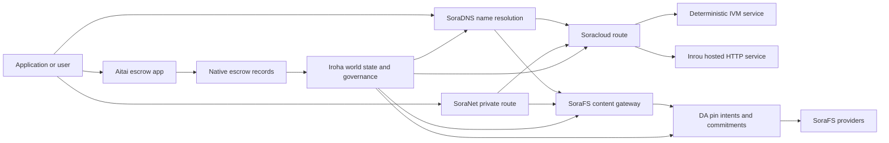

# SORA Nexus ဝန်ဆောင်မှုများ {#sora-nexus-services}

SORA Nexus သည် Iroha 3 အနီးတွင် app-facing service planes ကိုထည့်သွင်းသည်။ ဤဝန်ဆောင်မှုများသည် သီးခြား blockchain ledgers မဟုတ်ပါ။ ၎င်းတို့သည် Iroha ကမ္ဘာ့နိုင်ငံ၊ Norito နည်းပညာ manifest များ၊ အုပ်ချုပ်ရေးမှတ်တမ်းများနှင့် Torii လမ်းကြောင်းမိသားစုများမှချိတ်ဆက်ထားသည်။

ရရှိနိုင်မှုသည် နိုဒ် build နှင့် ကွန်ရက်ပရိုဖိုင်ပေါ် မူတည်သည်။ ပစ်မှတ်နိုဒ်တွင် ထုတ်လုပ်ထားသော အက်ပ် API လမ်းကြောင်းများကို ရှာဖွေရန် [`/openapi.json`](/my/reference/torii-endpoints.md#app-and-sora-route-families) ကို သုံးပါ။ အများသုံး စက်တွင်း SoraFS CID နှင့် လူသိများသော လမ်းကြောင်းများကို ထိုထုတ်လုပ်ထားသော စာတမ်းပြင်ပတွင် ချိတ်ထားသဖြင့် deployment ကို စစ်ဆေးရာ၌ ထိုလမ်းကြောင်းများကို တိုက်ရိုက်စမ်းသပ်ပါ။

## အစိတ်အပိုင်း မြေပုံ {#component-map}

|အစိတ်အပိုင်း |ကဏ္ဍ |အဓိက မျက်နှာပြင်များ |
| ---------------------- | ------------------------------------------------------------------------------------------------------------------------------------------- | ---------------------------------------------------------------------------------------- |
| Soracloud | အက်ပ် ဖြန့်ချိတပ်ဆင်မှု၊ host လုပ်ထားသော ဝန်ဆောင်မှုများ၊ သီးသန့် မော်ဒယ်/runtime အခြေအနေနှင့် ဝန်ဆောင်မှု သက်တမ်းစက်ဝန်း ထိန်းချုပ်မှု။ | `/v1/soracloud/*`၊ `/api/*`၊ `iroha soracloud service ...` |
|အတွင်းပိုင်း|Soracloud ဟာ တိုက်ရိုက် HTTP လေယာဉ်လိုတဲ့ ဝန်ဆောင်မှု အပြောင်းအလဲတွေအတွက် HTTP ဆော့ဝဲ အကောင်အထည်ဖော်ရေး ပတ်ဝန်းကျင်ကို ဟိုတယ်ပေးထားတယ်။ |Soracloud ဆော့ဝဲ အကောင်အထည်ဖော်ရေး ပတ်ဝန်းကျင် ညွှန်ကြားချက်, host အရည်အသွေး ကြော်ငြာများ, replica software အကောင်အ ထည်ဖော်ရေးပတ်ဝန်းကျင်အခြေအနေ |
|SoraNet |ဘက်ထရီများအတွက် သီးသန့်လွတ်လပ်မှုနှင့် ပို့ဆောင်ရေး overlay, relay traffic, VPN, ချိတ်ဆက်ခြင်းအခမ်းအနားများနှင့် streaming လမ်းကြောင်းများ။ |`/v1/connect/*`, `/v1/vpn/*`, SoraNet လမ်းကြောင်း metadata များ |
|ဒေတာရရှိနိုင်မှု (DA) |Nexus အကောင်အထည်ဖော်ရေးလမ်းကြောင်းများ၊ SoraFS နည်းပညာထုတ်ပြန်ချက်များနှင့် သက်သေပြမှု စီးဆင်းမှုတို့တွင် ရည်ညွှန်းထားသော အသုံးဝင်ဝန်ဆောင်မှုများအတွက် ရင်းနှီးမြှုပ်နှံမှု တန်ဖိုး၊ cryptographic commitment value နှင့် pin-intent layer များ။ |`/v1/da/*`, `FindDaPinIntent*`, `[nexus.da]`|
| SoraFS | Manifest များ၊ CAR payload များ၊ pin လုပ်ထားသော အကြောင်းအရာ၊ gateway မှ ရယူမှုများနှင့် ပြန်လည်ရယူနိုင်ကြောင်း proof လုပ်ငန်းစဉ်များအတွက် အကြောင်းအရာအလိုက် လိပ်စာသတ်မှတ်သည့် သိုလှောင်မှုစနစ်။ | `/v1/sorafs/*`၊ `/sorafs/*`၊ `FindSorafsProviderOwner` |
| SoraDNS | SORA Nexus တွင် host လုပ်ထားသော ဝန်ဆောင်မှုများနှင့် အကြောင်းအရာအတွက် တစ်သမတ်တည်း အမည်ပေးမှုနှင့် resolver သက်သေခံမှုအလွှာ။ | `/v1/soradns/*`၊ `/soradns/*`၊ resolver လမ်းညွှန် ဖြစ်ရပ်များ |
|Aitai |App-level fiat နဲ့ asset financial transaction settlement corridor ကို native escrow records တွေက ထောက်ခံပေးတယ် သီးခြား blockchain ledger ကနေမဟုတ်ဘူး|`OpenAssetEscrow`, `FindAssetEscrow*`, `EscrowEventFilter`, Kotodama `escrow_*` အဆောက်အအုံများ |



## သာမန်စီးဆင်းမှု {#common-flows}

### Hosted Split Application ကို အသုံးပြုခြင်း {#hosted-split-application}

ပုံမှန် Mixed-Plane App မှာ Pieces အားလုံးကို အတူတကွ သုံးပါတယ်။

1. Static frontend အရင်းအမြစ်များကို SoraFS မှတစ်ဆင့် ထုပ်ပိုး၍ ပိတ်ထားသည်။
2. ဥပမာ `<app>.sora` ကိုတော့ SoraDNS မှတဆင့် မှတ်ပုံတင်ထားပါတယ်။
3. Soracloud လမ်းကြောင်းများ `/api/v1/search` သို့မဟုတ် `/api/v1/stream` သို့ Inrou HTTP ဝန်ဆောင်မှုသို့။
4. Soracloud လမ်းကြောင်းများ `/api/auth` နှင့် `/api/v1/user` မှ deterministic IVM ကိုင်တွယ်သူများသို့။
5. ပုဂ္ဂိုလ်ရေးလုံခြုံမှု လိုအပ်တဲ့ ဖောက်သည်တွေဟာ SoraNet ပတ်လမ်းတစ်လျှောက်မှာ တူညီတဲ့ အကြောင်းအရာ (သို့) API လမ်းကြောင်းကို ရောက်ရှိနိုင်ကြပါတယ်။

|လမ်းကြောင်း|နောက်ခံ လေယာဉ် |ဘာကြောင့်လဲ|
| ----------------- | --------------------- | ------------------------------------------------- |
| `/`               |SoraFS တည်ငြိမ်မှု |ပြန်လည်ဖန်တီးနိုင်သော အကြောင်းအရာ root နှင့် gateway ကို cache လုပ်ခြင်း |
| `/assets/*` | SoraFS ၏ မပြောင်းလဲသော အကြောင်းအရာ | အကြောင်းအရာအလိုက် လိပ်စာသတ်မှတ်သော ပိုင်ဆိုင်မှုများနှင့် manifest proof များ |
|`/api/auth*` |Soracloud IVM |ပြန်လည်ကစားရန် လုံခြုံသော စာရင်းအင်းနှင့် ငွေကြေးစွန့်စားမှုအခြေအနေ |
|`/api/v1/user*` |Soracloud IVM |စီမံခန့်ခွဲမှုအတွက် ထိခိုက်လွယ်တဲ့ နိုင်ငံတော် အပြောင်းအလဲ |
|`/api/v1/search*` |Soracloud Inrou |တိုက်ရိုက် HTTP ဝန်ဆောင်မှု, ကေရှ်, SSE, သို့မဟုတ် စုဆောင်းသူအခြေအနေ |

### အကြောင်းအရာ ထုတ်ဝေခြင်း {#content-publication}

SoraFS ထုတ်ဝေမှုမှာ နာမည်တစ်ခုက သူတို့ကို ညွှန်းမပေးခင် သက်တမ်းရှည် ရှေးဟောင်းပစ္စည်းတွေကို ထုတ်လုပ်တယ်။

1. အသုံးဝင်တဲ့ ဝန်ဆောင်မှု (သို့) Directory ကို တည်ဆောက်ပါ။
2. ဒါကို CAR စာရွက်စာတမ်းထဲထည့်ပြီး အစိတ်အပိုင်းအစီအစဉ်ကို လုပ်ပါ။
3. Pin မူဝါဒနှင့် အုပ်ချုပ်မှုဒေတာပါသော Norito manifest ကို တည်ဆောက်ပါ။
4. Technical manifest ကို Torii သို့ တင်ပြပါ။
5. DA pin intent (သို့) availability cryptographic commitment value ကို မှတ်တမ်းတင်ပါ
6. Technical manifest ကို SoraDNS နာမည် (သို့) Soracloud တည်ငြိမ်တဲ့ ရှေ့ပြေးလမ်းကြောင်းနဲ့ ချိတ်ဆက်ပါ။

### ပုဂ္ဂလိကခေါ်ယူခြင်း (သို့) စီးဆင်းမှု လမ်းကြောင်း {#private-fetch-or-streaming-route}

SoraNet သည် SoraFS သို့မဟုတ် Soracloud ရှေ့မှာ ထိုင်နိုင်သည်-

1. ဖောက်သည်က နာမည် (သို့) Technical Manifesto ကို ဖြေရှင်းတယ်။
2. Guard လမ်းညွှန် သို့မဟုတ် လမ်းကြောင်း manifest က အဝင်နှင့် အထွက် relay များကို ရွေးချယ်သည်။
3. SoraNet ပတ်လမ်းကို ဖြတ်ပြီး ယာဉ်မောင်းတွေ ဖြည့်ပြီး ပို့ပေးတယ်။
4. SoraFS ဂိတ်တံခါး၊ Torii စီးကြောင်း သို့မဟုတ် Soracloud လမ်းကြောင်းသို့ ထွက်ပေါက်ဆက်သွယ်မှု ရောက်ရှိသည်။

## Aitai {#aitai}

Aitai သည် SORA app corridor ဖြစ်ပြီး ဝယ်ယူသူနှင့်ရောင်းသူသည် Iroha တွင်စျေးကွက်ပုံစံ ငွေကြေးငွေပေးချေမှုအတွက် Off-chain payment ကို ညှိနှိုင်းသည်။ ချိတ်ဆက်ထားတဲ့ အရင်းအမြစ် ထိန်းသိမ်းမှုကို ထိန်းချုပ်ပါတယ်။ စာရင်းအင်းပိုင် အာမခံစာရင်းအစား ဒေသခံ အာမခံညွှန်ကြားမှု မိသားစုကို အသုံးပြုပြီး ကိန်းဂဏန်းအရင်းအမြစ်ထိန်းသိမ်းမှု စီးဆင်းမှု အသစ်တွေအတွက် သုံးသင့်တယ်။

Native escrow သည် blockchain ledger တွင် custody ကို ထိန်းသိမ်းထားသည်။ ရောင်းသူသည် `OpenAssetEscrow` ဖြင့် ကမ်းလှမ်းမှုကိုဖွင့်ပြီး ၀ ယ်သူသည် `AcceptAssetEscrow` နှင့် `MarkEscrowPaymentSent` တို့ဖြင့် Off-chain ငွေပေးချေခြင်းကိုလက်ခံကာ အမှတ်တံဆိပ်ပေးသည်။ ရောင်းသူသည် `ReleaseAssetEscrow` ဖြင့်ထုတ်ပေးခြင်း သို့မဟုတ် ပေးချေမှုကို အမှတ်တံဆိပ်မထည့်မီ ဖျက်သိမ်းခြင်း။ ဝယ်သူနှင့်ရောင်းသူ သဘောမတူလျှင် နှစ်ဘက်စလုံးက ပဋိပက္ခဖွင့်နိုင်ပြီး `CanResolveEscrowDispute` နှင့်ဖြေရှင်းသူသည် ပိတ်ထားသောငွေကိုခွဲခြားနိုင်သည်။

Rust အကောင်အထည်ဖော်မှု စက်ဝန်းတစ်ခုလုံး၊ ယေဘုယျအရင်းအမြစ်ပိတ်ခြင်း၊ အမည်မသိဂိုဏ်း၊ မေးမြန်းချက်များ၊ ဖြစ်ရပ်များနှင့် ဥပမာများအတွက် [ပိုင်ဆိုင်မှုများကို စံညွှန်ကြားချက်ဖြင့် ကြားခံထိန်းသိမ်းခြင်း](/my/blockchain/escrow.md) ကိုကြည့်ရှုပါ။

|Aitai မျက်နှာပြင်|ဒါကို အသုံးပြုပါ။|
| ------------------------------------------------------------------------------------------------------------------------------------------------------------- | ----------------------------------------------------------------------------------------- |
|`OpenAssetEscrow`, `AcceptAssetEscrow`, `MarkEscrowPaymentSent`, `ReleaseAssetEscrow`, `CancelAssetEscrow` |ပွင့်လင်းမြင်သာသော ကိန်းဂဏန်း အရင်းအမြစ် ကမ်းလှမ်းချက်များ၊ XOR သို့ သတ်မှတ်ထားသည့် ငွေကြေးငွေပေးချေမှု ဖြေရှင်းရေး စီးဆင်းမှုများ အပါအဝင်။ |
|`OpenAnonymousAssetEscrow`, `AcceptAnonymousAssetEscrow`, `MarkAnonymousEscrowPaymentSent`, `ReleaseAnonymousAssetEscrow`, `CancelAnonymousAssetEscrow` |Shielded ကမ်းလှမ်းချက်တွေဟာ ငွေကြေးထောက်ပံ့မှုနဲ့ ပိတ်သိမ်းတဲ့ လှုပ်ရှားမှုတွေအတွက် သက်သေခံ အထောက်အထားကို သုံးပါတယ်။ |
|`OpenEscrowDispute`, `ResolveEscrowDispute`, `OpenAnonymousEscrowDispute`၊ `ResolveAnonymousEscrowDispute` |အငြင်းပွားမှုဖြေရှင်းရေးနဲ့ တရားရုံးပုံစံ ဆုံးဖြတ်ချက်ချခြင်း။|
|`FindAssetEscrowById`, `FindAssetEscrowsBySeller`, `FindAssetEscrowsByBuyer`၊ `FindAssetEscrowsByStatus` |App Status စာမျက်နှာများ၊ ညှိနှိုင်းမှု အလုပ်များနှင့် ထောက်ပံ့ရေး ကိရိယာများ။ |
|`EscrowEventFilter` |ပွင့်လင်းမြင်သာတဲ့ escrow subscriptions တွေကို escrow id၊ ရောင်းသူ၊ ဝယ်သူ၊ အခြေအနေ (သို့) အဖြစ်အပျက် အမျိုးအစားဖြင့် တိုက်ရိုက်ပေးသွင်းပါ။ |
| Kotodama `escrow_open_offer`, `escrow_accept`, `escrow_mark_payment_sent`, `escrow_release`, `escrow_cancel`, `escrow_open_dispute`, `escrow_resolve_dispute` |Kotodama သဘောတူစာချုပ်ခေါ်ဆိုမှုများကို V1 ကော်ပိုရေးရှင်းက ထောက်ခံသည်။ |

အများသုံး Taira သို့မဟုတ် Minamoto အသုံးပြုမှုအတွက် off-chain ငွေပေးချေမှုလမ်းကြောင်းနှင့် ပံ့ပိုးကူညီမှု သို့မဟုတ် တရားရုံးဆိုင်ရာ လုပ်ငန်းစဉ်များကို အပလီကေးရှင်းမူဝါဒအဖြစ် သတ်မှတ်ပါ။ Iroha သည် ထိန်းသိမ်းပိုင်ခွင့်အခြေအနေ၊ သက်တမ်းစက်ဝန်းဖြစ်ရပ်များ၊ သက်သေအထောက်အထားဆိုင်ရာ cryptographic hash များနှင့် ပိုင်ဆိုင်မှု၏ နောက်ဆုံးရွှေ့ပြောင်းမှုကို မှတ်တမ်းတင်သည်။ fiat ငွေရှင်းခြင်းကို မိမိဘာသာ အတည်မပြုပါ။

## Target Node ကို စစ်ဆေးပါ {#check-a-target-node}

ဤစာမျက်နှာမှ နမူနာများကို အသုံးပြုရန်မတိုင်မီ သင်ရည်မှန်းနေသည့် node တွင် route မိသားစုရှိသည်ကို စစ်ဆေးပါ-

```bash
export TORII_URL=https://taira.sora.org

curl -fsS "$TORII_URL/openapi.json" \
  | jq '.paths | keys[] | select(test("^/v1/(soracloud|sorafs|soradns|connect|vpn|da)/"))'

curl -fsS -H 'Accept: application/json' "$TORII_URL/status" | jq .
```

`/openapi.json` သည် စံ OpenAPI endpoint ဖြစ်သည်။ မည်သည့်လမ်းကြောင်းများ ရရှိနိုင်သည်ဆိုသည်မှာ build လုပ်ဆောင်ချက်များနှင့် ကွန်ရက်ပြင်ဆင်သတ်မှတ်မှုအပေါ် မူတည်သည်။ စာတမ်းတွင် အများသုံး စက်တွင်း SoraFS CID နှင့် လူသိများသော လမ်းကြောင်းများကို မစာရင်းပြုထားပါ။ ထို endpoint များကို အောက်တွင် ဖော်ပြထားသည့်အတိုင်း တိုက်ရိုက်စစ်ဆေးပါ။

### Taira အခြေခံလုပ်ဆောင်မှုကို ဖတ်ရှုရုံဖြင့် စစ်ဆေးခြင်း {#taira-read-only-smoke-checks}

အများပြည်သူ Taira API အကန့်အသတ်မှတ်ချက်ဟာ စာဖတ်ဘက် စစ်ဆေးမှုအတွက် အသုံးဝင်ပေမဲ့ ခွင့်ပြုထားတဲ့ အကောင့်ကို မောင်းနှင်ပြီး အများပြည်သူ testnet အခြေအနေကို ပြောင်းလဲဖို့ ရည်ရွယ်တာမဟုတ်ရင် ဗီဇပြောင်းတဲ့ နမူနာတွေအတွက်တော့ မသုံးပါနဲ့။

```bash
export TORII_URL=https://taira.sora.org

curl -fsS -H 'Accept: application/json' "$TORII_URL/status" \
  | jq '{version: .build.version, peers, blocks, lanes: (.teu_lane_commit | length)}'

curl -fsS "$TORII_URL/v1/vpn/profile" \
  | jq '{available, relay_endpoint, supported_exit_classes}'

curl -fsS "$TORII_URL/v1/sorafs/storage/peers?limit=4" \
  | jq '{gateway_base_url, pin_torii_urls}'

curl -fsS -H 'Accept: application/json' "$TORII_URL/v1/soracloud/status" \
  | jq '.control_plane | {service_count, services: [.services[] | {service_name, current_version}]}'
```

Taira သည် OpenAPI လမ်းကြောင်းမြေပုံတွင် ဖော်ပြထားခြင်းမရှိသော တပ်ဆင်မှုဆိုင်ရာ ထိန်းချုပ်ရေးလေယာဉ်လမ်းကြောင်းများကို ဖေါ်ပြနိုင်သည်။ ၎င်းပါဝင်သည့် လမ်းကြောင်းများအတွက် `/openapi.json` ကို ထုတ်လုပ်ထားသော စာချုပ်အဖြစ် မှတ်ယူပြီး တပ်ဆင်မှုနှင့် ပတ်သက်၍ ပြည်သူ့နေရာရှိ SoraFS လမ်းကြောင်းများကို လက်ရှိအတိုင်း မှတ်တမ်းတင်ရန် မတိုင်မီ တိုက်ရိုက် အတည်ပြုပါ။

## Soracloud {#soracloud}

Soracloud သည် SORA Nexus အက်ပ်များ၏ ထိန်းချုပ်မှုအလွှာဖြစ်သည်။ ၎င်းသည် deployment bundle များ၊ ဝန်ဆောင်မှု revision များ၊ လမ်းကြောင်းသတ်မှတ်မှု၊ ဖြန့်ချိမှုအခြေအနေ၊ တရားဝင် ပြင်ဆင်သတ်မှတ်မှုမှတ်တမ်းများ၊ စာဝှက်ထားသော ဝန်ဆောင်မှုလျှို့ဝှက်ချက်များ၊ မော်ဒယ်မှတ်ပုံတင်စာရင်းများ၊ သီးသန့် inference session များနှင့် runtime receipt များကို ခြေရာခံသည်။

Soracloud ဟာ စီမံခန့်ခွဲရေး လေယာဉ် နှစ်ခုကို သုံးပါတယ်။

|သတ်ဖြတ်ရေး လေယာဉ် |ဆော့ဝဲ အကောင်အထည်ဖော်မှု ပတ်ဝန်းကျင် |ဒါကို အသုံးပြုပါ။|
| ---------------------- | ------- | -------------------------------------------------------------------------------------------- |
|`DeterministicService` |`Ivm` |Author, vault state, certified readings, ordered mailbox handleers, governance-sensitive mutations |
|`HttpService` |`Inrou` |တိုက်ရိုက် HTTP APIs၊ စုဆောင်းရေး အလုပ်များ၊ ကေရှ်ထောက်ပံ့တဲ့ ဝန်ဆောင်မှုတွေ၊ SSE၊ ရှာဖွေရေးကိရိယာကူညီတဲ့ စီးဆင်းမှုတွေ |

ထိန်းချုပ်မှုအလွှာသည် အာဏာပိုင်မှတ်တမ်းဖြစ်သည်။ ဖြန့်ချိတပ်ဆင်ခြင်း၊ အဆင့်မြှင့်ခြင်း၊ နောက်ပြန်ပြောင်းခြင်း၊ ပြင်ဆင်သတ်မှတ်ခြင်း၊ လျှို့ဝှက်ချက်၊ မော်ဒယ်နှင့် အခြေအနေဆိုင်ရာ command များသည် Torii မှတစ်ဆင့် တင်သွင်းပြီး commit လုပ်ထားသော ကမ္ဘာလုံးဆိုင်ရာ အခြေအနေကို ဖတ်သည်။ သီးခြား CLI စက်တွင်း မိတ္တူကို အားမကိုးပါ။ အများသုံး လမ်းကြောင်းသတ်မှတ်မှုသည် အရှည်ဆုံး ရှေ့ဆက်အပေါ် အခြေခံသဖြင့် မှတ်ပုံတင်ထားသော host တစ်ခုက host လုပ်ထားသော HTTP လမ်းကြောင်းများနှင့် တစ်သမတ်တည်း API လမ်းကြောင်းများအကြား traffic ကို ခွဲပို့နိုင်သည်။

### Generated Starter Structure a Split App ကို {#scaffold-a-split-app}

split-app template က static frontend plus hosted live API နဲ့ deterministic vault/API ဝန်ဆောင်မှု တစ်ခုကို ဖန်တီးပါတယ်။

```bash
iroha soracloud app init \
  --template split-app \
  --app-name solswap_indexer \
  --app-version 0.1.0 \
  --public-host solswap-indexer.sora \
  --output-dir ./apps/solswap-indexer

iroha soracloud app plan \
  --manifest ./apps/solswap-indexer/app_manifest.json

iroha soracloud app doctor \
  --manifest ./apps/solswap-indexer/app_manifest.json
```

`plan` သည် လမ်းကြောင်းခွဲခြားချက်၊ ကလေးဝန်ဆောင်မှု နည်းပညာထုတ်ပြန်ချက်များ၊ အလုပ်ခွင်စာသားလမ်းကြောင်းများနှင့် ကြိုတင်မျှော်မှန်းထားသော ရှေ့ဆုံး ထုတ်ဝေပုံများကို ပုံနှိပ်သည်။ `doctor` သည် Torii ကို ပါဝင်ရန်မတိုင်မီ ဒေသတွင်းထုတ်လွှင့်မှု စာချုပ်ကို အတည်ပြုပေးသည်။

### App State ကို စေလွှတ်ပြီး စစ်ဆေးခြင်း {#deploy-and-inspect-app-state}

ပြန်လည်သုံးပါ SoraFS အနာဂတ်ထိန်းသိမ်းမှုကာလတစ်ခု ထုတ်ဝေခြင်း၏ပြန်လည်ကြိုးစားမှုတိုင်းအတွက်။ split-app နမူနာမှာ Inrou ဝန်ဆောင်မှုရှိသည့်ကြောင့်, အွန်လိုင်းအပြောင်းအလဲမတိုင်မီရွေးချယ်သော offline provider ဆိုင်များတွင်၎င်း၏တိကျသောလက်ရာပစ္စည်းကိုသတ်မှတ်ပါ။

```bash
export SORACLOUD_TORII_URL=https://<soracloud-enabled-torii>
export SORAFS_RETENTION_EPOCH=<future-unix-seconds>

iroha soracloud app preseed \
  --manifest ./apps/solswap-indexer/app_manifest.json \
  --sorafs-retention-epoch "$SORAFS_RETENTION_EPOCH" \
  --inrou-preseed-target <validator-account,peer-id,absolute-store-path> \
  --inrou-preseed-max-capacity-bytes <bytes> \
  --inrou-preseed-helper /absolute/path/to/sorafs-node \
  --inrou-preseed-helper-sha256 <lowercase-sha256> \
  --receipt-out /absolute/path/to/solswap-inrou-preseed.json

iroha soracloud app release \
  --manifest ./apps/solswap-indexer/app_manifest.json \
  --sorafs-retention-epoch "$SORAFS_RETENTION_EPOCH" \
  --inrou-preseed-receipt /absolute/path/to/solswap-inrou-preseed.json \
  --torii-url "$SORACLOUD_TORII_URL"

iroha soracloud app status \
  --manifest ./apps/solswap-indexer/app_manifest.json \
  --torii-url "$SORACLOUD_TORII_URL"
```

`--inrou-preseed-target` ကို ဖြန့်ဖြူးရေး မူဝါဒအရ လိုအပ်တဲ့ ပေးသွင်းသူစတိုးတိုင်းအတွက် ထပ်မံလုပ်ပါ။ `release` က နည်းပညာ manifesto တွေကို တည်ဆောက်ပြီး synchronizes လုပ်ပေးတယ်၊ app doctor ကို run လုပ်တယ်။ protocol-standard app infrastructure တစ်ခုတည်းသော ဗီဇပြောင်းမှုတစ်ခုတင်သွင်းခြင်း၊ အာဏာပိုင်အခြေအနေကို ညှိနှိုင်းခြင်းနှင့် ကြေညာထားသော live target များအား စစ်ဆေးခြင်း။ Inrou artefacts ကိုပါဝင်သည့် app တွင် pre-set protocol ရလဒ်မှတ်တမ်းသည်ရွေးချယ်စရာမဟုတ်ပါ။

အသုံးပြုပြီးသား ဝန်ဆောင်မှုအတွက် Service-scale command ကို သုံးပါ။

```bash
iroha soracloud service status \
  --service-name solswap_indexer_live \
  --torii-url "$SORACLOUD_TORII_URL"

iroha soracloud service rollback \
  --service-name solswap_indexer_live \
  --target-version 0.1.0 \
  --torii-url "$SORACLOUD_TORII_URL"
```

### လျှို့ဝှက်ပစ္စည်းများ {#config-and-secret-material}

Soracloud ၏ ပြင်ဆင်သတ်မှတ်မှုနှင့် လျှို့ဝှက်ချက်မှတ်တမ်းများသည် အာဏာပိုင် deployment အခြေအနေ၏ အစိတ်အပိုင်းဖြစ်သည်။ လိုအပ်သော ပြင်ဆင်သတ်မှတ်မှု သို့မဟုတ် လျှို့ဝှက်ချက်ချိတ်ဆက်မှုများ ပျောက်နေပါက၊ သို့မဟုတ် အသက်ဝင် manifest များနှင့် မကိုက်ညီပါက ဖြန့်ချိတပ်ဆင်ခြင်း၊ အဆင့်မြှင့်ခြင်းနှင့် နောက်ပြန်ပြောင်းခြင်းကို လက်မခံဘဲ ပိတ်ပင်သည်။

```bash
iroha soracloud service config-set \
  --service-name solswap_indexer_live \
  --config-name indexer/public_config \
  --value-file ./config/public-config.json \
  --torii-url "$SORACLOUD_TORII_URL"

iroha soracloud service secret-set \
  --service-name solswap_indexer_live \
  --secret-name indexer/api_key \
  --secret-file ./secrets/api-key.envelope.json \
  --torii-url "$SORACLOUD_TORII_URL"
```

CLI အကူအညီကို အသုံးပြုပြီး ကိုယ်ရေးကိုယ်တာအချက်အလက်အတွက် လိုအပ်တဲ့ တိကျတဲ့ မှတ်ပုံတင်အမှတ်တံဆိပ်များကို ရှာဖွေပါ။

```bash
iroha soracloud service config-set --help
iroha soracloud service secret-set --help
```

## Inrou {#inrou}

Inrou က ဧည့်သည်ပါ။ HTTP အသုံးပြုသော software execution environment ကို Soracloud. အန် Iroha embedded node နှင့်အတူ node Soracloud ဆော့ဝဲ အကောင်အထည်ဖော်ရေး ပတ်ဝန်းကျင် စီမံကိန်းများ လက်ခံ Soracloud ဒေသတွင်း ရုပ်လုံးဖေါ်ရေး အစီအစဉ်တစ်ခုထဲ ထည့်သွင်းထားပြီး သတ်မှတ်ထားတဲ့ hosted-service replicas တွေကို loopback services အဖြစ် စတင်ပေးပါတယ်။ အစီရင်ခံစာများနှင့် software execution ပတ်ဝန်းကျင်အခြေအနေကိုအမှန်တကယ်မော်ဒယ်သို့ပြန်ပို့။

Collector-heavy APIs, SSE streams, cache backed handleers သို့မဟုတ် browser assisted services တို့လို live HTTP မျက်နှာပြင်လိုအပ်တဲ့ workload များအတွက် Inrou ကိုအသုံးပြုပါ။

### ဆော့ဝဲ အကောင်အထည်ဖော်ရေး ပတ်ဝန်းကျင် လိုအပ်ချက်များ {#runtime-requirements}

- Container Technical Manifesto software ကို အကောင်အထည်ဖော်တဲ့ ပတ်ဝန်းကျင်က `Inrou` ဖြစ်ရပါမယ်။
- ဝန်ဆောင်မှုနည်းပညာထုတ်ပြန်ချက် အကောင်အထည်ဖော်ရေးစက်က `HttpService` ဖြစ်ရပါမယ်။
- `HttpService + Inrou` အတိအကျ တစ်ခုကို လိုအပ်တယ်။ `PersistentRootLeaseVolume` တပ်ဆင်ထားသည် `/`.
- Inrou ဝန်ဆောင်မှုများကို ပြန်လည်ဖန်တီးခြင်းသည်လည်း ပြောင်းလဲနိုင်သော မျှဝေထားသော အခြေအနေကို ထိန်းသိမ်းထားပါက မျှဝေထားသည့် ဝန်ဆောင်မှု (သို့) လျှို့ဝှက်ငှားစာရင်း သိုလှောင်ရန် လိုအပ်သည်။
- Production တွင် host လုပ်သော နိုဒ်များသည် proxy အဖြစ်သာ လည်ပတ်မည့်အစား အမှန်တကယ်ရှိသော Inrou စွမ်းရည်ကို ကြေညာသင့်သည်။

### Technical Manifesto Fragment {#manifest-fragment}

အောက်ပါဥပမာမှာ Technical Manifesto နှစ်ခုရဲ့ ပုံစံကို ပြထားပါတယ်။ ဒါက အစိတ်အပိုင်းတစ်ခုဖြစ်ပြီး ဖြန့်ဖြူးမှုအပြည့်အဝမဟုတ်ဘူး။

```jsonc
// container_manifest.json
{
  "schema_version": 1,
  "runtime": { "runtime": "Inrou", "value": null },
  "bundle_path": "/bundles/solswap-indexer.inrou",
  "entrypoint": "/app/bin/launch-indexer.sh",
  "args": [],
  "env": {
    "RUST_LOG": "info",
  },
  "inrou": {
    "schema_version": 1,
    "guest_os": { "guest_os": "DebianSlim", "value": null },
    "guest_images": {
      "x86_64": {
        "kernel_image_path": "/inrou/x86_64/vmlinux",
        "rootfs_image_path": "/inrou/x86_64/rootfs.ext4",
        "initrd_image_path": null,
      },
      "aarch64": {
        "kernel_image_path": "/inrou/aarch64/vmlinux",
        "rootfs_image_path": "/inrou/aarch64/rootfs.ext4",
        "initrd_image_path": null,
      },
    },
  },
  "lifecycle": {
    "start_grace_secs": 60,
    "stop_grace_secs": 30,
    "healthcheck_path": "/api/indexer/v1/health",
  },
}
```

```jsonc
// service_manifest.json
{
  "schema_version": 1,
  "service_name": "solswap_indexer_live",
  "service_version": "0.1.0",
  "execution_plane": { "execution_plane": "HttpService", "value": null },
  "replicas": 2,
  "route": {
    "host": "solswap-indexer.sora",
    "path_prefix": "/api/v1/search",
    "service_port": 8080,
    "visibility": { "visibility": "Public", "value": null },
    "tls_mode": { "tls": "Required", "value": null },
  },
  "lease_volumes": [
    {
      "volume_name": "root_disk",
      "kind": {
        "lease_volume": "PersistentRootLeaseVolume",
        "value": null,
      },
      "storage_class": { "storage_class": "Warm", "value": null },
      "mount_path": "/",
      "max_total_bytes": 8589934592,
    },
    {
      "volume_name": "index_state",
      "kind": { "lease_volume": "ServiceLeaseVolume", "value": null },
      "storage_class": { "storage_class": "Warm", "value": null },
      "mount_path": "/var/lib/solswap-indexer",
      "max_total_bytes": 1073741824,
    },
  ],
}
```

ဆော့ဖ်ဝဲ အကောင်အထည်ဖော်မှု ပတ်ဝန်းကျင်မှာ၊ တပ်ဆင်ထားတဲ့ လိုင်စင်ပမာဏတစ်ခုစီဟာ ပမာဏအမည်မှ ရယူထားသော ပတ်ဝန်းကျင် ကိန်းရှင်များဖြင့် ထုတ်လွှင့်ခြင်းခံနေရသည်။

```text
SORACLOUD_LEASE_VOLUME_ROOT_DISK_DIR
SORACLOUD_LEASE_VOLUME_ROOT_DISK_MOUNT_PATH
SORACLOUD_LEASE_VOLUME_INDEX_STATE_DIR
SORACLOUD_LEASE_VOLUME_INDEX_STATE_MOUNT_PATH
```

## SoraNet {#soranet}

SoraNet သည် ကိုယ်ရေးလုံခြုံမှုနှင့် ပို့ဆောင်မှုဆိုင်ရာ ထပ်ဆင့်ကွန်ရက်ဖြစ်သည်။ ပစ်မှတ် gateway သို့မဟုတ် ဝန်ဆောင်မှုကို တိုက်ရိုက်မချိတ်ဆက်သင့်သော traffic အတွက် relay အခြေပြု လမ်းကြောင်းများကို ပေးသည်။ ပို့ဆောင်မှုပုံစံသည် အဝင်၊ အလယ်နှင့် အထွက် relay တာဝန်များ၊ QUIC ပို့ဆောင်မှု၊ Noise အခြေပြု ပေါင်းစပ် handshake၊ လုပ်နိုင်စွမ်း ညှိနှိုင်းမှု၊ relay လမ်းညွှန် metadata နှင့် အရွယ်အစားတူအောင် ဖြည့်ထားသော cell များကို သုံးသည်။

SORA Nexus deployment များတွင် SoraNet သည် အကြောင်းအရာရယူမှုများ၊ gateway traffic၊ VPN သို့မဟုတ် Connect session များနှင့် Norito streaming လမ်းကြောင်းများကို သယ်ဆောင်နိုင်သည်။ လမ်းညွှန်မှတ်တမ်းများက `norito-stream` ကို ပံ့ပိုးသော relay များအား အမှတ်အသားပြုနိုင်သဖြင့် client များသည် Torii RPC သို့မဟုတ် streaming traffic အတွက် သင့်လျော်သော လမ်းကြောင်းများကို ဦးစားပေးနိုင်သည်။

### Stream ပို့ဆောင်မှု ပြင်ဆင်သတ်မှတ်ခြင်း {#streaming-configuration}

Nexus ပရိုဖိုင်သည် SoraNet ကို streaming လမ်းကြောင်းများအတွက် ထောက်ပံ့နိုင်စေသည်။

```toml
[streaming]
feature_bits = 0b11

[streaming.soranet]
enabled = true
exit_multiaddr = "/dns/torii/udp/9443/quic"
padding_budget_ms = 25
access_kind = "authenticated"
provision_spool_dir = "./storage/streaming/soranet_routes"
provision_spool_max_bytes = 0
provision_window_segments = 4
provision_queue_capacity = 256
```

`access_kind = "read-only"` ကို ကြည့်ရှုသူအား စစ်ဆေးရန် မလိုသော အကြောင်းအရာလမ်းကြောင်းများအတွက် အသုံးပြုပါ။ `authenticated` ကို သုံးပါ exit relay သည် Torii သို့သို့မဟုတ် ဟိုတယ်ဝန်ဆောင်မှုတစ်ခုသို့ မရောက်မီလက်မှတ်များ (သို့) ကြည့်ရှုသူ၏ ကိုယ်ပိုင်လက္ခဏာကို အကောင်အထည်ဖော်ရမည့်အခါ။

### SoraNet-သိရှိထားသည် SoraFS ခေါ်ယူ {#soranet-aware-sorafs-fetch}

နိုင်ငံတကာ SoraFS ရယူခြင်း CLI ဒေသတွင်းကိုယ်စားလှယ်လက်မှတ်နှင့် spool ထုတ်လွှင့်နိုင်သည် SoraNet browser extension တွေအတွက် route metadata သို့မဟုတ် SDK Adapter တွေ၊ orchestrator JSON သတ်မှတ်ပေးရပါမယ်။ `local_proxy` နှင့်အတူ `"emit_browser_manifest": true`, နောက်ပြီး CLI ဆောက်လုပ်ရမယ်။ `local-quic-proxy` ထောက်ပံ့မှု။ Taira, အများပြည်သူ testnet root မှာ ခွင့်ပြုထားတဲ့ ပေးသွင်းသူ စာရင်းကို စစ်ဆေးပါ။ ထို့နောက် ထိုပေးသွင်းသူအတွက် ထုတ်ဝေသော ကာကွယ်ထားသည့် ပေးသွင်းသူ tuple ကိုဖြည့်ပါ။

```bash
export TAIRA_ROOT=https://taira.sora.org
curl -fsS "$TAIRA_ROOT/v1/sorafs/providers?limit=20" | jq '.providers'

: "${TAIRA_SORAFS_PROVIDER_ID:?set the admitted provider ID from Taira discovery}"
: "${TAIRA_SORAFS_GATEWAY_KEY:?set the provider gateway key}"
: "${TAIRA_SORAFS_PROVIDER_URL:?set the advertised provider base URL}"
: "${TAIRA_SORAFS_STREAM_TOKEN_FILE:?set the issued stream-token file}"

cargo run -p sorafs_orchestrator --features=local-quic-proxy --bin=sorafs_cli -- \
  fetch \
  --plan=artifacts/payload_plan.json \
  --manifest-id=<manifest-digest-hex> \
  --orchestrator-config=artifacts/orchestrator.json \
  --provider=name=taira,provider-id="$TAIRA_SORAFS_PROVIDER_ID",gateway-key="$TAIRA_SORAFS_GATEWAY_KEY",base-url="$TAIRA_SORAFS_PROVIDER_URL",stream-token="$(cat "$TAIRA_SORAFS_STREAM_TOKEN_FILE")" \
  --output=artifacts/payload.bin \
  --json-out=artifacts/fetch_summary.json \
  --local-proxy-manifest-out=artifacts/proxy_manifest.json \
  --local-proxy-mode=bridge \
  --local-proxy-norito-spool=storage/streaming/soranet_routes \
  --local-proxy-kaigi-spool=storage/streaming/soranet_routes \
  --local-proxy-kaigi-policy=authenticated \
  --max-peers=2 \
  --retry-budget=4
```

အနှစ်ချုပ်မှတ်တမ်းပေးသူ အစီရင်ခံစာများ၊ ချပ်ပရိုတိုကော ရလဒ် မှတ်တမ်းများ၊ ဒေသဆိုင်ရာ ကိုယ်စားလှယ် မီတာဒေတာများနှင့် ကောက်ယူမှုအတွက် အသုံးပြုသော ထိရောက်တဲ့ လမ်းကြောင်း သတ်မှတ်ချက်များကို။

### Relay Incentive စစ်ဆေးသူစာရင်း {#relay-incentive-verifier-roster}

`incentives.enable` မှန်ကန်ပါက `incentives.trusted_verifier_ids` တွင် အနည်းဆုံး ပရိုတိုကုတ်စံညွှန်းစာရင်း ID တစ်ခုသာ ပါဝင်ရမည်ဖြစ်သည်။ စာရင်းသည် 64 ကိုမကျော်ရပါ။ ဆော့ဖ်ဝဲ အကောင်အထည်ဖော်မှု ပတ်ဝန်းကျင်က Deterministic Ordered Set အဖြစ် သိမ်းဆည်းထားပြီး Relay startup အတွင်းမှာ invalid roster geometry ကို ပယ်ချလိုက်ပါတယ်။

`RelayBandwidthProofV1` တစ်ခုစီကို သတ်မှတ်ထားသော frame/မှတ်ဉာဏ်ခွဲဝေမှု ဘတ်ဂျက်အတွင်း decode လုပ်ပြီး frame တစ်ခုလုံးကို အသုံးပြုကုန်ရမည်။ Relay က ၎င်း၏ စွမ်းဆောင်ရည်စုစည်းကိန်းကို lock လုပ်ခြင်း သို့မဟုတ် ပြောင်းလဲခြင်း မပြုမီ proof ၏ စစ်ဆေးသူအကောင့်သည် ပြင်ဆင်သတ်မှတ်ထားသော စာရင်းတွင် ရှိရမည်ဖြစ်ပြီး `RelayBandwidthProofV1::verify_signature()` အောင်မြင်ရမည်။ ထို့ကြောင့် မယုံကြည်ရသော လက်မှတ်ထိုးသူ သို့မဟုတ် လက်မှတ်မမှန်သော/ပြုပြင်ခံထားရသော proof က တိုင်းတာချက် မထည့်ဝင်နိုင်သကဲ့သို့ ဆုကြေး snapshot ကိုလည်း မထုတ်လုပ်နိုင်ပါ။

## ဒေတာရရှိနိုင်မှု (DA) {#data-availability-da}

DA သည် world state တွင် တိုက်ရိုက်ထည့်ရန်အတွက် အလွန်ကြီးမားသော၊ ပုဂ္ဂလိကရေးရာနှင့် စပ်လျဉ်းသည့် (သို့) ဝန်ဆောင်မှုဆိုင်ရာ သီးသန့်ပစ္စည်းများအတွက် အသုံးပြုနိုင်စွမ်းအထောက်အထား အလွှာဖြစ်သည်။ Deterministic cryptographic commitment values နဲ့ retrieval obligations တွေကို မှတ်တမ်းတင်ထားလို့ validator တွေ၊ gateways တွေနဲ့ client တွေက ဘယ် byte ကတိပေးခဲ့လဲ၊ ဘယ်မူဝါဒကို သုံးပြီး ဘယ်သက်သေတွေကို စောင့်ကြည့်ခဲ့တာလဲ ဆိုတာကို သဘောတူနိုင်ကြပါတယ်။

DA သည် Kura သို့မဟုတ် SoraFS ကိုအစားထိုးခြင်းမရှိပါ။

- Kura က နောက်ဆုံးသတ်မှတ်ထားတဲ့ block stream နဲ့ consensus recovery data တွေကို သိမ်းထားတယ်။
- SoraFS က Content Addressed Byte တွေ၊ CAR အသုံးဝင် ဝန်ဆောင်မှုတွေ နဲ့ Technical Manifesto တွေကို သိမ်းပိုက်ပြီး ပို့ပေးပါတယ်။
- DA သည် cryptographic commitment တန်ဖိုးများ၊ proof မူဝါဒများ၊ proof openings များနှင့် pin intent များကို မှတ်တမ်းတင်ထားပြီး ထို byte များကို အစီအစဉ်ချရန်၊ စစ်ဆေးရန်နှင့် blockchain ledger အခြေအနေသို့ ပြန်လည်ဆက်သွယ်ရန်ခွင့်ပြုသည်။

DA ကို အသုံးပြုပါ Application သို့မဟုတ် Nexus Execution Lane သည် blockchain ledger တွင် မြင်နိုင်သော Off-chain ဒေတာများကို ပြန်လည်ရရှိနိုင်ရန် ကတိပြုချက်တစ်ခုလိုအပ်တဲ့အခါမှာ။ သာမန်ဥပမာများမှာ ငွေကြေးလုပ်ငန်းစဉ်ဖြေရှင်းမှု စီးဆင်းမှုအတွက် အသုံးဝင်လမ်းအပြည့်အဝ cryptographic commitment တန်ဖိုးများ၊ ထုတ်ဝေထားသော အကြောင်းအရာအတွက် SoraFS pin intent များဖြစ်သည်။ နောက်ပိုင်း စစ်ဆေးမှုအတွက် ထိန်းသိမ်းထားရမယ့် သက်သေခံအစုတွေနဲ့ အများပြည်သူသိတဲ့ အချက်အလက်ဖြစ်သင့်တဲ့ အက်ပ်လက်ရာတွေဟာ အပြည့်အဝ အသုံးဝင်တဲ့ ဝန်ဆောင်မှုအစား cryptographic digest value ဖြစ်သင့်ပါတယ်။

### သက်တမ်း စက်ဝန်း {#lifecycle}

|အဆင့် |မှတ်တမ်းတင်ထားတာက ဘာလဲ။|
| ---------- | ----------------------------------------------------------------------------------------------------------------------------------------------------- |
|ရည်ရွယ်ချက်|Ticket, technical manifest reference, alias, lane/epoch/sequence reference, retention policy သို့မဟုတ် replication target များကို မှတ်တမ်းတင်ရန်။|
|cryptographic commitment တန်ဖိုး |cryptographic digest value material ဟာ technical manifest, execution lane payload, proof bundle (သို့) content root တွေကို blockchain ledger record ထဲမှာ မြင်ရတဲ့ အရာတွေနဲ့ ချိတ်ဆက်ပေးပါတယ်။ |
| အထောက်အထား | ရရှိနိုင်မှု မဲများ၊ proof ဖွင့်ပြချက်များ၊ provider သက်သေခံချက်များ သို့မဟုတ် ပစ်မှတ်ကွန်ရက်က လက်ခံသော ပရိုဖိုင်အလိုက် အခြားအထောက်အထားများ။ |
| Query | `FindDaPinIntentByTicket`၊ `FindDaPinIntentByManifest`၊ `FindDaPinIntentByAlias` သို့မဟုတ် `FindDaPinIntentByLaneEpochSequence` မှတစ်ဆင့် pin ရည်ရွယ်ချက်ကို ရှာဖွေခြင်း။ |

ပုံမှန် DA ထောက်ပံ့တဲ့ ထုတ်ဝေမှု စီးဆင်းမှုဟာ-

1. WSV အပြင်မှာရှိတဲ့ အသုံးဝင် ဝန်ဆောင်မှုကို တည်ဆောက်ခြင်း (သို့) လက်ခံရရှိခြင်း၊ ဥပမာ SoraFS CAR ဖိုင် သို့မဟုတ် Nexus အကောင်အထည်ဖော်ရေးလမ်းကြောင်း အသုံးဝင်ဝန်ဆောင်မှုပါ။
2. Norito Technical Manifesto (သို့) Route-Specific Cryptographic Engagement Value Record တွင် အသုံးဝင်သော ဝန်ဆောင်မှုကို ဖော်ပြရန်။
3. ထိုလမ်းကြောင်းအုပ်စုကို ဖွင့်ထားလျှင် `/v1/da/*` မှတစ်ဆင့်၊ သို့မဟုတ် ကွန်ရက်၏ လက်မှတ်ထိုးထားသော transaction လမ်းကြောင်းမှတစ်ဆင့် manifest၊ pin ရည်ရွယ်ချက် သို့မဟုတ် ကတိပြုတန်ဖိုးကို တင်သွင်းပါ။
4. validator သို့မဟုတ် availability provider တွေကို Active Proof Policy က တောင်းဆိုတဲ့ အထောက်အထားတွေကို စုစည်းခွင့်ပြုပါ။
5. ငွေကြေးလုပ်ငန်း settlement proof (သို့မဟုတ်) payload မှီခိုသော gateway route ကို promote မလုပ်ခင် resulting pin intent သို့မဟုတ် cryptographic commitment value ကို မေးမြန်းပါ။

### အယ်လ်ဂိုရစ်သမ်ပုံစံ {#algorithmic-model}

DA သည် အသုံးဝင်သော ဝန်ဆောင်မှုကို လက်မှတ်ထိုးပြီး ပြန်လည်ကစားကာကွယ်ထားသည့် ဘလော့-အညွှန်းထားတဲ့ cryptographic commitment value အဖြစ်ပြောင်းလဲစေသည်။ အရေးကြီးသော အယ်လ်ဂိုရစ်သမ်များသည် သတ်မှတ်ချက်များဖြစ်သည်၊ ထို့ကြောင့် validators နှင့် gateways တို့သည်တူညီသော byte များမှတူညီသော cryptographic digests ကိုပြန်လည်တွက်နိုင်သည်။

1. Torii သည် `(lane_id, epoch, sequence)` နှင့်အတူ ၀ ယ်ယူမှုတောင်းဆိုချက်ကိုလက်ခံသည်၊ အသုံးဝင်ဘိုက်များ, ဖိနှိပ်ခြင်း metadata များ, အပိုင်းအရွယ်အစား, ဖျက်ပစ်ရေးပရိုဖိုင်, ထိန်းသိမ်းရေးမူဝါဒနှင့်ပို့သူ၏ လက်မှတ်. node က request လုပ်တဲ့အခါ gzip, deflate (သို့) Zstandard payload တွေကို decompress လုပ်ပြီး protocol တစ်ခုတည်းရဲ့ standard byte length ကို `total_size` နဲ့ညီတယ်ဆိုတာကို စစ်ဆေးပါတယ်။
2. အကောင်အထည်ဖော်ရေးလမ်းကြောင်းနှင့် အပိုင်းသတ်မှတ်ချက်များကို ခိုင်ခံ့စေရန်။ အကောင်အ ထည်ဖော်ရေး လမ်းကြောင်းသည် Nexus အကောင်အတန့်လမ်းကြောင်းစာရင်းတွင် တည်ရှိရမည်ဖြစ်သည်။ `chunk_size` သည် သုညမဟုတ်သော စွမ်းအား ၂, အနည်းဆုံး ၂ ဘိုက်တာဖြစ်ရမည်။ ပြင်ဆင်ထားသော အမြင့်ဆုံးထက်မကြီးပါ။ ဖျက်ပစ်ရေးပရိုဖိုင်မှာ ဒေတာအပိုင်းအစများနှင့် အနည်းဆုံး parity shards နှစ်ခုပါဝင်ရမည်။ အကောင်အထည်ဖော်မှုလမ်းကြောင်းစာရင်းတွင် သက်သေခံစနစ် `merkle_sha256` သို့မဟုတ် `kzg_bls12_381` ကိုရွေးချယ်သည်။
3. **ကွန်ရက်မူဝါဒကို အသုံးချပါ။** နိုဒ်သည် blob အမျိုးအစားအတွက် ပြင်ဆင်သတ်မှတ်ထားသော မိတ္တူပြုလုပ်မှုနှင့် ထိန်းသိမ်းထားမှု အခြေခံသတ်မှတ်ချက်ကို အတည်ပြုကျင့်သုံးသည်။ အများမြင် metadata ကို မစာဝှက်ထားရပါ။ အုပ်ချုပ်မှုအတွက်သာ ဖြစ်သော metadata ကို manifest ထဲမရေးမီ နိုဒ်တွင် ပြင်ဆင်သတ်မှတ်ထားသော အုပ်ချုပ်မှု metadata ကီးဖြင့် စာဝှက်သည်။
4. **အပိုင်းခွဲ၍ ကတိပြုတန်ဖိုး ဖွဲ့စည်းပါ။** စံ payload ကို `chunk_size` မှ ဆင်းသက်ထားသော အရွယ်အစားပုံသေ ပရိုဖိုင်ဖြင့် အပိုင်းခွဲသည်။ Torii သည် payload digest၊ ပြန်လည်ရယူနိုင်ကြောင်း proof သစ်ပင်၏ အမြစ်နှင့် အပိုင်းတစ်ခုစီ၏ ကတိပြုတန်ဖိုးများကို တွက်သည်။ ဒေတာအပိုင်းများတွင် ၎င်းတို့၏ byte များအပေါ် တွက်ထားသော BLAKE3 ကတိပြုတန်ဖိုးများ ပါဝင်သည်။
5. `data_shards` ၏ strips များသို့စုစည်းထားသည်။ နောက်ဆုံး stripe တွင်ပျောက်ဆုံးဆဲလ်များသည် parity တွက်ချက်ရန် သုည padded ဖြစ်ပါသည်။ RS(16) parity သည် row/global parity shards များကိုဖန်တီးသည်; ရွေးချယ်စရာ `row_parity_stripes` သည် matrix တစ်လျှောက်တွင် column-style stripe parity ကိုထည့်သွင်းသည်။ parity shard cryptographic commitment တန်ဖိုးများမှာ BLAKE3 သေးငယ်သော endiaine `u16` သင်္ကေတများ၏ cryptographic digests ဖြစ်သည်။
6. **Manifest ကို တည်ဆောက်ပါ။** `DaManifestV1` သည် lane၊ epoch၊ blob အမျိုးအစား၊ codec၊ payload digest၊ အပိုင်းအမြစ်၊ အပိုင်းအရွယ်အစား၊ ဖျက်ပျောက်မှုခံနိုင်ရေး ပရိုဖိုင်၊ ထိန်းသိမ်းမှုမူဝါဒ၊ ငှားရမ်းခ quote၊ အပိုင်းကတိပြုတန်ဖိုးများ၊ ရွေးချယ်နိုင်သော IPA ကတိပြုတန်ဖိုး၊ metadata နှင့် ထုတ်ပေးချိန်တို့ကို မှတ်တမ်းတင်သည်။ သိုလှောင်မှု ticket သည် တစ်သမတ်တည်းဖြစ်သည်။ နိုဒ်က ticket အလွတ်ပါသော manifest ပုံစံ၏ ဟက်ရှ်ကို ဦးစွာတွက်ပြီး ထိုလက်ဗွေကို နောက်ဆုံး `storage_ticket` အဖြစ် ပြန်ရေးသည်။
7. **ပြန်လည်တင်သွင်းမှု ပဋိပက္ခများကို ငြင်းပယ်ပါ။** ပြန်လည်တင်သွင်းမှု ကီးမှာ `(lane_id, epoch, sequence, manifest_fingerprint)` ဖြစ်သည်။ လက်ဗွေတူသော ထပ်တူတင်သွင်းမှုသည် ရလဒ်မပြောင်းပါ။ အစဉ်နံပါတ်ဟောင်း သို့မဟုတ် အစဉ်နံပါတ်တူသော်လည်း လက်ဗွေမတူသော တင်သွင်းမှုကို ငြင်းပယ်သည်။
8. လက်မှတ်ထိုးလက်ရာများကို ထုတ်ပေးပါ။ Torii သည် PDP cryptographic commitment တန်ဖိုးကို တွက်ချက်ပြီး `DaIngestReceipt` ကို လက်မှတ်ရေးထိုးကာ `DaCommitmentRecord` ကို တည်ဆောက်ပြီး နည်းပညာထုတ်ပြန်ချက်အတွက် spool artefacts များ၊ PDP cryptographic engagement value, cryptographic commit value record တို့ကို ရေးသားသည်။ cryptographic commitment value schedule, pin intent, protocol result record file, and protocol result record log. protocol result record cursor ကို `(lane_id, epoch)` အတိုင်း monotonously advance လုပ်ပေးတယ်။

cryptographic commitment value record တွေကို blocks တွေက သယ်ဆောင်ပါတယ်။ မှတ်တမ်းတစ်ခုက

- အကောင်အထည်ဖော်မှုလမ်းကြောင်း၊ ခေတ်ကာလနှင့် အစဉ်
- Caller blob ID နဲ့ Single Protocol Standard Technical Manifesto ကို cryptographic hash လုပ်ထားတယ်။
- အကောင်အထည်ဖော်ရေးလမ်းကြောင်း သက်သေခံစနစ်
- အစိတ်အပိုင်း အမြစ်
- KZG အကောင်အထည်ဖော်ရေးလမ်းကြောင်းများအတွက် ရွေးချယ်စရာ KZG လျှို့ဝှက်ချေးငွေတန်ဖိုး။
- PDP/အထောက်အထားသော cryptographic digest value
- ထိန်းသိမ်းမှုတန်းအစားနဲ့ သိုလှောင်ရေးလက်မှတ်
- Torii DA မှတ်ပုံတင်လက်မှတ်

Block တစ်ခုမှာ DA မှတ်တမ်းတွေ ထည့်သွင်းမထားခင်၊ block assembly path က bundle ကို validates:

- `(lane_id, epoch, sequence)` ဟာ အိတ်အတွင်းမှာ ထူးခြားဖို့လိုတယ်။
- Technical manifest cryptographic hashs တွေဟာ အစုအတွင်းမှာ သုညမဟုတ်ဘဲ တစ်ကိုယ်ရေဖြစ်ဖို့လိုပါတယ်။
- Cryptographic commitment value proof scheme ကတော့ configured execution lane policy နဲ့ ကိုက်ညီဖို့လိုပါတယ်။
- Merkle သတ်ဖြတ်မှုလမ်းကြောင်းများ ငြင်းပယ် KZG cryptographic commitment values များ၊ KZG အကောင်အထည်ဖော်မှုလမ်းကြောင်းများအတွက် သုညမဟုတ်သော KZG cryptographic commitment value ကို သတ်မှတ်ပေးပါ။
- Pin ရည်ရွယ်ချက်များကို အကောင်အထည်ဖော်မှုလမ်းကြောင်း၊ နည်းပညာ manifest cryptographic hash, သိုလှောင်ရေးလက်မှတ်၊ ပိုင်ရှင်စာရင်းနှင့် alias တိုက်မိမှု စည်းမျဉ်းများဖြင့် ကန်နိုနီကာစီ၊ အမျိုးအစားခွဲခြားပြီး စစ်ဆေးသည်။

ဘလော့ခ်ခေါင်းစီးသည် DA proof မူဝါဒများ၊ ကတိပြုတန်ဖိုးများနှင့် pin ရည်ရွယ်ချက်များအတွက် ဟက်ရှ်များကို သိမ်းသည်။ အဖွဲ့ဝင်ဖြစ်ကြောင်း proof များအတွက် ကတိပြုတန်ဖိုး bundle က Merkle အမြစ်ကိုလည်း ပေးသည်။ ၎င်း၏ အရွက်များမှာ စံ Norito ဖြင့် encode လုပ်ထားသော `DaCommitmentRecord` တန်ဖိုးများ၏ ဟက်ရှ်များဖြစ်သည်။ မိဘ node များသည် ဘယ်နှင့်ညာ ကလေးတို့ကို ဆက်ထားခြင်း၏ ဟက်ရှ်ကို တွက်သည်။ အဖော်မရှိသော နောက်ဆုံးအရွက်ကို မပြောင်းဘဲ နောက်အလွှာသို့ တင်ပေးသည်။

### အထောက်အထား စစ်ဆေးခြင်း {#proof-verification}

`/v1/da/commitments/prove` သည် block တစ်ခုတွင် cryptographic commitment တန်ဖိုးတစ်ခုအတွက် သက်သေပြနိုင်သည်။ သက်သေပြချက်မှာ cryptographic engagement တန်ဖိုး၊ block အမြင့်၊ bundle ထဲက index, bundle cryptographic hash, bundle length, Merkle root နှင့် sibling path တို့ပါဝင်သည်။ စစ်ဆေးမှုစစ်ဆေးမှုများ:

1. proof bundle cryptographic hash သည် block header ၏ DA binding value ၏ cryptographic Hash ကိုက်ညီသည်။
2. proof block height က referenced block header နဲ့ ကိုက်ညီပါတယ်။
3. အညွှန်းကိန်းသည် ကန့်သတ်ချက်များတွင်ရှိပြီး cryptographic commitment value သည် ထိုအညွှန်းကိန်း၏ bundle entry ကိုညီမျှသည်။
4. အကောင်အထည်ဖော်မှုလမ်းကြောင်း သက်သေခံမူဝါဒသည် cryptographic commitment value ကိုလက်ခံသည်။
5. cryptographic commitment value sheet ကနေ ညီအစ်ကိုချင်းလမ်းကြောင်းကို ခေါက်လိုက်ရင် ပေးထားတဲ့ အမြစ်ကို ပြန်လည်တည်ဆောက်ပါတယ်။
6. ပြန်လည်တည်ဆောက်ထားတဲ့ အမြစ်က အစုအမြစ်နဲ့ညီတယ်။

ဤအချက်သည် သတ်မှတ်သော ဘလော့က အသုံးဝင်မှုတွင် သီးသန့်ရရှိနိုင်သည့် cryptographic commitment value ကို ထည့်သွင်းထားကြောင်း သက်သေပြနေသော်လည်း လက်ရှိမှာ replica တစ်ခုစီသည် အွန်လိုင်းတွင် ရှိသည်ကို သက်သေမပြပါ။ Live retrievability ကို SoraFS ဝန်ဆောင်မှုပေးသူများထံမှ ရယူခြင်း၊ PDP/PoTR စစ်ဆေးခြင်း သို့မဟုတ် ပရိုဖိုင်းအတွက် သီးသန့်ရရှိမှု အထောက်အထားများဖြင့် သီးခြားစစ်ဆေးသည်။

### သဘောတူညီချက် တုံ့ပြန်ဆက်သွယ်မှု {#consensus-interaction}

သဘောတူညီချက်အထောက်အပံ့ ဝန်ဆောင်မှုရရှိမှုက အမိန့်ချမှတ်ထားပေမဲ့ ဒါက ဒုတိယ အဆုံးသတ် ပရိုတိုကောမဟုတ်ဘူး။ ခေါင်းဆောင်က လက်မှတ်ထိုးထားတဲ့ `PayloadManifest` ကို `3f + 1` ကော်မတီတစ်ခုလုံးသို့ ထုတ်လွှင့်တယ်။ ပထမအဖွဲ့နှင့် RS16 အစိတ်အပိုင်းဖြစ်ပွားမှုရည်မှန်းချက်များက Set A ဖြစ်သည်။ ၎င်း၏ `2f + 1` အဖွဲ့ဝင်များသည် ခေါင်းဆောင်နှင့် ကိုယ်စားလှယ်အနောက်ကိုပါ ၀ င်သည်။ ကန့်သတ်ထားသော တူညီသောအမြင်ပြန်လည်လွှင့်တင်ခြင်းသည် ခန္ဓာကိုယ်နှင့် အစိတ်အပိုင်း ဝန်ဆောင်မှုကို ကော်မတီတစ်ခုလုံးသို့ ကျယ်ပြန့်စေသည်။

Technical Manifesto (သို့) Partial Shard Set ကို မဲပေးဖို့ လုံလောက်တာမဟုတ်ဘူး။ Prepare မတိုင်ခင် validator တစ်ခုချင်းစီဟာ chunks တွေကို စစ်ဆေးဖို့လိုပြီး တစ်ကိုယ်လုံး single protocol-standard body ကို ပြန်လည်တည်ဆောက်ဖို့လိုတယ်။ ၎င်းရဲ့အလျား၊ chunk root နဲ့ body cryptographic hash ကို စစ်ဆေးပြီး အဲဒီ body ကို persist လုပ်ပြီး deterministic block validation ကို ပြီးစီးပါ။ validator က CommitQC application သို့မဟုတ် certified recovery မှတစ်ဆင့် တိကျတဲ့ body ကို ထိန်းသိမ်းထားတယ်။

Network peer တစ်ခုဟာ ကိုယ်ခန္ဓာကို မပိုင်ဆိုင်ခင်မှာ လက်မှတ်တစ်ခုကို သင်ယူတဲ့အခါ ပထမဦးဆုံး စစ်ဆေးထားတဲ့ အပိုင်းအစတွေ (သို့) Single Protocol Standard Body ကို လက်မှတ်ရေးထိုးသူတွေကနေ တောင်းဆိုပြီး ဒီနောက် ပြန်လည်ရှာဖွေမှုကို အေးခဲတဲ့ ကော်မတီဆီ တိုးချဲ့တယ်။ တုံ့ပြန်မှုတိုင်းဟာ တိကျတဲ့ အမြင့် အခြေအနေ၊ အဆိုပြုချက် ပတ်ဝန်းကျင်၊ နည်းပညာထုတ်ပြန်ချက်နဲ့ ကိုယ်ခန္ဓာ အကြောင်းအရာကို ဆက်စပ်နေဆဲပါ။ ဒေသတွင်း ပြန်လည်တည်ဆောက်ထားတဲ့ ကိုယ်ခန္ဓာက လက်မှတ်နဲ့ ကိုက်ညီပြီးနောက်ပဲ ဘလော့က သုံးတာပါ။

### လုပ်ငန်းရှင် မှတ်စုများ {#operator-notes}

Iroha 3 consensus ပရိုဖိုင်များတွင် လက်မှတ်ထိုးထားသော manifest နှင့် RS16 payload ဖြန့်ဝေမှု၊ Prepare မတိုင်မီ body အပြည့်အစုံ စစ်ဆေးမှု၊ DA bundle စစ်ဆေးမှုနှင့် ကန့်သတ်ထားသော ပြန်လည်ရယူမှု telemetry တို့ အမြဲပါဝင်သည်။ Layout နှင့် ပရိုတိုကောကန့်သတ်ချက်များကို လက်မှတ်ထိုးထားသော အမြင့်အကြောင်းအရာတွင် မပြောင်းလဲအောင် သတ်မှတ်ထားသည်။ ၎င်းတို့ကို ပိတ်နိုင် သို့မဟုတ် ပြန်သတ်မှတ်နိုင်သော စက်တွင်း ခလုတ် သို့မဟုတ် အချိန်ကုန်ဆုံးမှု ပရိုဖိုင် မရှိပါ။ နိုဒ်စက်တွင်း ဘလော့ခ်နှင့် တန်းစီစာရင်း ကန့်သတ်ချက်များသည် deployment ၏ လက်မှတ်ထိုးထားသော layout နှင့် အလုပ်ပမာဏကို လိုက်လျောညီထွေ ဖြစ်နေရန် လိုအပ်သေးသည်။

လမ်းကြောင်းရှာဖွေရေးအတွက် node ရဲ့ OpenAPI စာရွက်စာတမ်းနဲ့စပါ။

```bash
curl -fsS "$TORII_URL/openapi.json" \
  | jq '.paths | keys[] | select(startswith("/v1/da/"))'
```

လက်ရှိ DA query အမည်များအတွက် [query ကိုးကားချက်](/my/reference/queries.md#nexus-data-availability-and-packages) ကို သုံးပါ။ အက်ပ်အဆင့် `[nexus.da]` ဒေတာလက်ခံမှု၊ နမူနာယူမှု၊ စာရင်းစစ်မှု၊ ပြန်လည်ရယူမှု ကန့်သတ်ချက်များနှင့် စက်တွင်း Sumeragi ဘလော့ခ်နှင့် တန်းစီစာရင်း ကန့်သတ်ချက်များအတွက် [peer ပြင်ဆင်သတ်မှတ်မှု ပုံစံ](/my/reference/peer-config/) ကို သုံးပါ။

## SoraFS {#sorafs}

SoraFS သည် ဗဟိုချုပ်ကိုင်မှုမရှိသော အကြောင်းအရာအလိုက် လိပ်စာသတ်မှတ်သည့် သိုလှောင်မှုစနစ်ဖြစ်သည်။ ၎င်းသည် byte များကို တစ်သမတ်တည်း အပိုင်းများ၊ CAR archive များနှင့် အကြောင်းအရာအမြစ်၊ အပိုင်းခွဲပရိုဖိုင်၊ pin မူဝါဒနှင့် အုပ်ချုပ်မှုသက်သေခံချက်များကို ချည်နှောင်သော Norito manifest များအဖြစ် ထုပ်ပိုးသည်။ သိုလှောင်မှု provider များက စွမ်းရည်နှင့် အကြောင်းအရာရရှိနိုင်မှုကို ကြေညာပြီး gateway များက အကြောင်းအရာမပေးမီ manifest နှင့် အပိုင်းကတိပြုတန်ဖိုးများကို စစ်ဆေးသည်။

သာမန် SoraFS အသုံးပြုမှုများမှာ static application assets များ၊ documentation builds များ၊ zone များ ပါဝင်သည်။ အုပ်ချုပ်မှု အထောက်အထားများ၊ မော်ဒယ် (သို့) လက်ရာအကိုးအကားများ။ Iroha ဒေတာပုံစံ ထုတ်ပြန်ချက်များ SoraFS Gateway ဖြစ်ရပ်များနှင့် [`FindSorafsProviderOwner`](/my/reference/queries.md#nexus-data-availability-and-packages) ပေးသွင်းသူပိုင်ခွင့်ဖြေရှင်းမှုအတွက် မေးမြန်းချက်။

### Taira စမ်းသပ်ကွန်ရက် ပရိုဖိုင် {#taira-testnet-profile}

Taira သည် စံအများသုံး SoraFS စမ်းသပ်ကွန်ရက်ဖြစ်သည်။ Repository ထဲရှိ ၎င်း၏ validator ပရိုဖိုင်သည် chain `fc56984b-2be7-431d-840e-21514d1883f0` နှင့် chain ခွဲခြားတန်ဖိုး `369` ကို သုံးသည်။ အောက်ပါ `NetworkId` သည် လက်ရှိပုံသေသတ်မှတ်ထားသော Taira genesis ၏ အထောက်အထားအတိအကျဖြစ်သည်။ Taira ကို reset လုပ်လျှင် chain အမည်ကို ထိန်းထားသော်လည်း ထိုဟက်ရှ် ပြောင်းနိုင်သဖြင့် လက်ရှိ လက်မှတ်ထိုးထားသော deployment ပရိုဖိုင်မှ ၎င်းကို အသစ်ပြန်ယူပါ။ Chain UUID မှ လုံးဝ မဆင်းသက်တွက်ချက်ပါနှင့်။ Taira တွင် အကျိုးသက်ရောက်နေသော SoraFS ဆက်တင်များမှာ -

- ကွန်ရက် ID: `hash:82531CE8EAE8BFF6BEECA4698BFD13A3BC8BEC5F0EE0D23D428C97FC17AB0F3B#3E94`
- Gateway Base URL: `https://taira.sora.org`
- ခေါက်ဆွဲ Torii URLs: `https://taira-validator-1.sora.org` ဖြတ်သန်း `https://taira-validator-4.sora.org`
- တွေ့ရှိနိုင်စွမ်းများ: `torii_gateway`, `chunk_range_fetch`, နှင့် `potr_mldsa`
- သီးခြားပါဝင်မှု မူရင်း: `https://{cid}.sorafs.taira.sora.org/{path}`
- အများပြည်သူ PIN မူဝါဒ - ခွင့်ပြုချက်မရှိ၊ အခွန်မပေးဘဲ `require_council_signatures = false`

```toml
[sorafs.storage]
enabled = false
max_capacity_bytes = 13743895347

[sorafs.discovery]
discovery_enabled = true
known_capabilities = ["torii_gateway", "chunk_range_fetch", "potr_mldsa"]

[sorafs.discovery.admission]
envelopes_dir = "configs/soranexus/taira/sorafs_admission"
trusted_council_keys = ["REPLACE_WITH_TAIRA_SORAFS_COUNCIL_PUBLIC_KEY"]
signature_threshold = "REPLACE_WITH_TAIRA_SORAFS_COUNCIL_SIGNATURE_THRESHOLD"

[sorafs.discovery.publish]
gateway_base_url = "https://taira.sora.org"
pin_torii_urls = [
  "https://taira-validator-1.sora.org",
  "https://taira-validator-2.sora.org",
  "https://taira-validator-3.sora.org",
  "https://taira-validator-4.sora.org",
]

[sorafs.gateway]
require_manifest_envelope = true
enforce_admission = true
enforce_capabilities = true

[sorafs.gateway.untrusted_hosting]
enabled = true
path_gateway_redirect = true
redirect_html_only = true

[sorafs.gateway.untrusted_hosting.cid_host_suffixes]
live = "sorafs.sora.org"
taira = "sorafs.taira.sora.org"

[sorafs.repair]
enabled = false
claim_ttl_secs = 900
heartbeat_interval_secs = 60
max_attempts = 3
worker_concurrency = 4

[sorafs.gc]
enabled = false
interval_secs = 900
max_deletions_per_run = 500
retention_grace_secs = 86400

[gov.sorafs_pin_policy]
require_council_signatures = false
```

အဆင့်မြင့်ဂိတ်ဝေ့ (gateway) တန်ဖိုးသုံးခုဟာ အမွေခံရတဲ့ ကျရှုံးမှုပိတ်ထားတဲ့ ကြိုတင်အဓိပ္ပာယ်သတ်မှတ်ချက်တွေဖြစ်ပြီး အပိုဒ်ထဲက အခြားတန်ဖိုးအားလုံးက Taira ရဲ့ စစ်ဆေးထားတဲ့ ပရိုဖိုင်မှာ ရှင်းလင်းပါတယ်။ လုပ်ငန်းရှင်တစ်ဦးသည် ရှာဖွေတွေ့ရှိမှု-လက်မှတ်ထိုးနေရာပိုင်ရှင်များကို လက်မှတ်ရေးထိုးထားသော ဖြန့်ချိမှုပစ္စည်းဖြင့် အစားထိုးရမည်ဖြစ်သည်။ ပေးပို့သည့် တောင်းဆိုချက်တိုင်းတွင် နည်းပညာပြဌာန်းချက် အချက်အလက် ကွန်တိန်နာတစ်ခု၊ လက်မှတ်ပေးသွင်းသူလက်မှတ်ထိုးခြင်းနှင့် ကြော်ငြာပြုလုပ်ထားသော အရည်အသွေးကို အသုံးပြုရမည်။

Taira validator များတွင် ထည့်သွင်းထားသော SoraFS သိုလှောင်မှု၊ ပြုပြင်မှုနှင့် အမှိုက်ရှင်းလင်းမှုကို ပိတ်ထားသည်။ ပြင်ဆင်သတ်မှတ်ထားသော စွမ်းရည်သည် validator ဒစ်ဘတ်ဂျက် စစ်ဆေးမှု၏ အစိတ်အပိုင်းဖြစ်နေဆဲဖြစ်ပြီး validator က သိုလှောင်မှု provider ဖြစ်ကြောင်း မဆိုလိုပါ။ မစမ်းသပ်မီ လက်ရှိ ပြင်ဆင်သတ်မှတ်ထားသော gateway နှင့် pin ဦးတည်ရာများကို ဖတ်ရန် `GET /v1/sorafs/storage/peers?limit=4` ကို သုံးပါ။

Taira ၏ schema ပြင်ဆင်သတ်မှတ်မှုသည် CID host နောက်ဆက်ကီးများဖြစ်သည့် `live` နှင့် `taira` နှစ်ခုလုံးကို လက်ခံသည်။ အများသုံး စမ်းသပ်ကွန်ရက် manifest များ၊ origin စစ်ဆေးမှုများနှင့် browser စမ်းသပ်ချက်များသည် မိမိတို့၏ origin က Taira နှင့် ချိတ်ထားကြောင်း ထင်ရှားစေရန် `sorafs.taira.sora.org` ကို သုံးသင့်သည်။ `live` ကီးကို လက်ခံခြင်းအား production ဟု ထင်ရသော origin အောက်တွင် စမ်းသပ်ကွန်ရက် အကြောင်းအရာကို ထုတ်ဝေရန် အကြံပြုချက်ဟု မယူဆပါနှင့်။ အခြား deployment များသည် မိမိတို့၏ ကွန်ရက်အထောက်အထား၊ အုပ်ချုပ်မှုကီးများ၊ provider ဝင်ခွင့်ဆိုင်ရာ ပစ္စည်းများ၊ pin endpoint များနှင့် စွမ်းရည်/ပြုပြင်မှု မူဝါဒကို သုံးရမည်။

### အများသုံး စက်တွင်း CID နှင့် ဆိုက် Gateway များ {#public-local-cid-and-site-gateways}

SoraFS အားသွင်းထားသော Torii node တစ်ခုစီသည် API ရွေးချယ်စရာ app ကို မတည်ဆောက်ပါကတောင်မှ ဤမည်မသိ အများသုံးလမ်းကြောင်းများကို တပ်ဆင်သည်။

|Method နဲ့ API အဆုံးသတ်မှတ်ချက် |ရည်ရွယ်ချက်|
| ---------------------------------- | -------------------------------------------------------------------- |
|`GET /.well-known/sorafs/manifest` |Single Protocol Standard request host က ရွေးချယ်ထားတဲ့ Technical Manifesto ကို ပြန်ပို့ပါ။ |
|`GET /v1/sorafs/cid/{cid}` |ကန့်သတ်ထားတဲ့ ဒေသတွင်း နည်းပညာထုတ်ပြန်ချက် metadata နဲ့ CID တစ်ခုအတွက် file entry တွေကို ပြန်ပေးပါ။ |
|`GET /sorafs/cid/{cid}` |ဒေသတွင်း အကြောင်းအရာများနှင့် ပတ်သက်သော ဝက်ဘ်ဆိုဒ်တစ်ခုအတွက် Root စာရွက်စာတမ်းကို ဖြည့်စွက်ပေးရန် |
|`GET /sorafs/cid/{cid}/{*path}` |CID အောက်မှာ ပုံမှန်လမ်းကြောင်းတစ်ခု (သို့) အကန့်အသတ်ထားတဲ့ ဘိုက်တာအကွာအဝေး တစ်ခုကို ဖွင့်ပါ။ |

ဤလမ်းကြောင်းများသည် `x-sorafs-stream-token` သို့မဟုတ် `x-sorafs-token-id` ကို ဘယ်တော့မှ လက်မခံပါ။ ခေါင်းစဉ်နှစ်ခုစလုံးရှိခြင်းသည်မကောင်းသောတောင်းဆိုချက်တစ်ခုဖြစ်သည်။ node ၏အာဏာပိုင် ဒေသတွင်းတွင်အခုပင်ရှိနေသည့် single protocol-standard technical manifest တစ်ခုတည်း။ သိုလှောင်သည် အများပြည်သူဖတ်နိုင်စွမ်းဖြစ်သည်; ကေရှ်ပျောက်ကွယ်မှုကဝေးလံပေးသွင်းသူ hydration ကိုခွင့်မပြုပါ။ ကာကွယ်သောပေးသွင်းသူ CAR နှင့် chunk လမ်းကြောင်းများသည် သီးခြားအတည်ပြုထားတဲ့ ပရိုတိုကောမျက်နှာပြင်များအဖြစ်ကျန်ရစ်သည်။

Byte များကို မဖတ်မီ Torii သည် စက်တွင်း manifest ၏ စံ encoding၊ အဓိပ္ပာယ်ဆိုင်ရာ ကန့်သတ်ချက်များ၊ digest နှင့် root CID ကို စစ်ဆေးသည်။ ထို့နောက် manifest၊ CID နှင့် provider အတွက် အာဏာပိုင် စက်တွင်း provider အထောက်အထား၊ အုပ်ချုပ်မှုအရ ဝင်ခွင့်နှင့် အုပ်ချုပ်မှုဖြင့် သတ်မှတ်ထားသော စည်းကမ်းလိုက်နာမှုတို့ကို လိုအပ်သည်။ Gateway ၏ နှုန်းကန့်သတ်/ပိတ်ပင်မှု မူဝါဒသည် အကျိုးသက်ရောက်သော client လိပ်စာကို သုံးပြီး ပြင်ဆင်သတ်မှတ်ထားသော ယုံကြည်ရသည့် proxy များမှသာ ထပ်ဆင့်ပို့သောလိပ်စာကို လက်ခံသည်။ မူဝါဒ၊ စည်းကမ်းလိုက်နာမှု၊ အထောက်အထား သို့မဟုတ် ဝင်ခွင့်အခြေအနေ မရှိလျှင် လက်မခံဘဲ ပိတ်ပင်သည်။

တောင်းဆိုမှုတစ်ခုသည် အစမှအဆုံးအထိ အများသုံး gateway ခွင့်ပြုလက်မှတ်တစ်ခုကို ကိုင်ထားသည်။ Process တစ်ခုလုံး၌ တစ်ပြိုင်နက် ဖတ်ရှုမှု 64 ခုအထိသာ ခွင့်ပြုပြီး ပိုလျှံသော တောင်းဆိုမှုများကို `503 Service Unavailable` နှင့် `Retry-After: 1` ပြန်ပေးသည်။ Manifest အဖြေများကို 16 MiB အထိ ကန့်သတ်သည်။ ဖိုင်စာရင်းသည် မူလအတိုင်း မှတ်တမ်း 50 ခုဖြစ်ပြီး အများဆုံး 500 ခု ပြန်ပေးသည်။ ဖိုင်အပြည့် သို့မဟုတ် byte အပိုင်းအခြားတစ်ခုကို 8 MiB အထိ ကန့်သတ်သည်။ Query parse လုပ်ပုံသည် build ပေါ်မူတည်သည်။ ဖြန့်ချိသော `app_api` build သည် decode လုပ်ပြီးသော အပေါင်း/အနုတ်လက္ခဏာမပါသော 32-bit `limit` ကို လက်ခံပြီး အခြား query ကီးများကို လျစ်လျူရှုသည်။ `limit` ထပ်ပါလျှင် နောက်ဆုံးတန်ဖိုးကို ယူပြီး `1..=500` အတွင်းသို့ ကန့်သတ်ညှိပေးသည်။ `app_api` မပါသော လုပ်ဆောင်ချက်အနည်းဆုံး build သည် စံ `limit=1..500` အတွဲတစ်ခုတည်းကိုသာ လက်ခံပြီး မသိသော၊ ထပ်ပါသော၊ ရာခိုင်နှုန်းဖြင့် encode လုပ်ထားသော သို့မဟုတ် စံမဟုတ်သော ပုံစံများကို ငြင်းပယ်သည်။ Build များအကြား တူညီသော အပြုအမူရရန် `limit=<1..500>` အတွဲ တစ်ခုတည်းကို အတိအကျ ပို့ပါ။ CIDs၊ host များ၊ လမ်းကြောင်းများနှင့် range ခေါင်းစီးများသည် build နှစ်မျိုးလုံးတွင် စံပုံစံနှင့် တန်ဖိုးတစ်ခုတည်း ဖြစ်ရမည်။ လုပ်ဆောင်နိုင်သော HTML၊ CSS၊ JavaScript၊ SVG၊ XML၊ PDF သို့မဟုတ် Wasm အကြောင်းအရာကို ပြင်ဆင်သတ်မှတ်ထားသော CID မှ ဆင်းသက်သည့် သီးခြား origin မှသာ ပေးသည် (သို့မဟုတ် ထိုနေရာသို့ ပြန်ညွှန်သည်)။ ဤနည်းဖြင့် မျှဝေသုံးသော path gateway origin တွင် မယုံကြည်ရသော အကြောင်းအရာ လုပ်ဆောင်ခြင်းကို တားဆီးသည်။

### စုစည်းခြင်း၊ တည်ဆောက်ခြင်းနှင့် တင်ပြခြင်း {#pack-build-and-submit}

အောက်ပါ ပြောင်းလဲရေးဥပမာသည် လက်ရှိပုံသေသတ်မှတ်ထားသော Taira `NetworkId`၊ pin endpoint၊ မိတ္တူအရေအတွက် အနိမ့်ဆုံးနှင့် အုပ်ချုပ်မှုမူဝါဒကို သုံးသည်။ ငွေရှိသော စမ်းသပ်ကွန်ရက်အကောင့်နှင့် ပိုင်ရှင်သာ ဖတ်နိုင်သည့် ယာယီကီးဖိုင်ကို သုံးပါ။ Taira သည် ကောင်စီလက်မှတ်မပါဘဲ ခွင့်ပြုချက်တောင်းစရာမလိုသော pin များကို လက်ခံသော်လည်း အုပ်ချုပ်မှုအရ သတ်မှတ်ထားသော အခကြေးငွေကို ကောက်ခံနေဆဲဖြစ်သည်။

```bash
cargo run -p sorafs_orchestrator --bin sorafs_cli -- \
  car pack \
  --input=./dist \
  --car-out=artifacts/site.car \
  --plan-out=artifacts/site.chunk-plan.json \
  --summary-out=artifacts/site.car-summary.json

: "${TAIRA_AUTHORITY:?set a funded Taira I105 account}"
export TAIRA_NETWORK_ID='hash:82531CE8EAE8BFF6BEECA4698BFD13A3BC8BEC5F0EE0D23D428C97FC17AB0F3B#3E94'
export TAIRA_PIN_TORII_URL=https://taira-validator-1.sora.org
export TAIRA_PRIVATE_KEY_FILE="${TAIRA_PRIVATE_KEY_FILE:-./secrets/taira-authority.ed25519}"
export TAIRA_RETENTION_EPOCH=$(( $(date -u +%s) + 86400 ))

cargo run -p sorafs_orchestrator --bin sorafs_cli -- \
  manifest build \
  --summary=artifacts/site.car-summary.json \
  --manifest-out=artifacts/site.manifest.to \
  --manifest-json-out=artifacts/site.manifest.json \
  --pin-min-replicas=1 \
  --pin-storage-class=warm \
  --pin-retention-epoch="$TAIRA_RETENTION_EPOCH"

cargo run -p sorafs_orchestrator --bin sorafs_cli -- \
  manifest submit \
  --manifest=artifacts/site.manifest.to \
  --chunk-plan=artifacts/site.chunk-plan.json \
  --torii-url="$TAIRA_PIN_TORII_URL" \
  --network-id="$TAIRA_NETWORK_ID" \
  --authority="$TAIRA_AUTHORITY" \
  --private-key-file="$TAIRA_PRIVATE_KEY_FILE" \
  --summary-out=artifacts/site.manifest.submit.json \
  --response-out=artifacts/site.manifest.submit.body
```

`manifest submit` သည် `/v1/sorafs/pin/register` ကိုလိုအပ်သည်။ ရည်မှန်းချက် node က ၎င်းကို လမ်းညွှန်မပေးပါက အမိန့်သည် ကျရှုံးသွားလိမ့်မည်။ ပထမဆုံးထုတ်ပြန်မှု CLI သည် ယေဘုယျ `/transaction` API အဆုံးသတ်မှတ်တိုင်သို့ ပြန်မဝင်ပါ။

### စစ်ဆေးပြီး ယူလာပါ {#verify-and-fetch}

ကာကွယ်ထားသော fetch တန်ဖိုးတွဲသည် provider တစ်ခုစီအလိုက် သီးခြားဖြစ်သည်။ ၎င်း၏ provider ID နှင့် ကြေညာထားသော အခြေခံ URL ကို Taira ၏ provider catalog မှ ရယူပြီး gateway ကီးနှင့် stream token ကို ထို provider ၏ ဝင်ခွင့်လုပ်ငန်းစဉ်မှ ရယူပါ။ ဤတန်ဖိုးများသည် validator သိုလှောင်မှုဆက်တင်များ မဟုတ်ပါ။ Repository ထဲရှိ Taira validator များတွင် ထည့်သွင်းသိုလှောင်မှု ပိတ်ထားသဖြင့် provider URL အစား validator ၏ pin URL ကို မသုံးပါနှင့်။

```bash
export TAIRA_ROOT=https://taira.sora.org
curl -fsS "$TAIRA_ROOT/v1/sorafs/providers?limit=20" | jq '.providers'

: "${TAIRA_SORAFS_PROVIDER_ID:?set the admitted provider ID from Taira discovery}"
: "${TAIRA_SORAFS_GATEWAY_KEY:?set the provider gateway key}"
: "${TAIRA_SORAFS_PROVIDER_URL:?set the advertised provider base URL}"
: "${TAIRA_SORAFS_STREAM_TOKEN_FILE:?set the issued stream-token file}"

cargo run -p sorafs_orchestrator --bin sorafs_cli -- \
  proof verify \
  --manifest=artifacts/site.manifest.to \
  --car=artifacts/site.car \
  --chunk-plan=artifacts/site.chunk-plan.json \
  --summary-out=artifacts/site.verify.json

cargo run -p sorafs_orchestrator --bin sorafs_cli -- \
  fetch \
  --plan=artifacts/site.chunk-plan.json \
  --manifest-id=<manifest-digest-hex> \
  --provider=name=taira,provider-id="$TAIRA_SORAFS_PROVIDER_ID",gateway-key="$TAIRA_SORAFS_GATEWAY_KEY",base-url="$TAIRA_SORAFS_PROVIDER_URL",stream-token="$(cat "$TAIRA_SORAFS_STREAM_TOKEN_FILE")" \
  --output=artifacts/site.fetch.tar \
  --json-out=artifacts/site.fetch.json
```

### ပြန်လည်ရရှိနိုင်မှု သက်သေပြချက် စစ်ဆေးမှုများ {#proof-of-retrievability-checks}

Operators များသည် proof-of-retrievability ရလဒ်များကို စစ်ဆေး၊ တင်ပို့၍ အစီရင်ခံနိုင်သည်။ စိန်ခေါ်မှုများအား ကွန်ရက်၏ proof software processing workflow မှစီစဉ်ထားပြီး CLI သည် ရလဒ်များကို မျက်နှာပြင်ပေါ်တွင် ဖော်ပြပေးသည်။

```bash
cargo run -p sorafs_orchestrator --bin sorafs_cli -- \
  por status \
  --torii-url="$TAIRA_PIN_TORII_URL" \
  --manifest=<manifest-digest-hex> \
  --status=failed \
  --limit=20

cargo run -p sorafs_orchestrator --bin sorafs_cli -- \
  por report \
  --torii-url="$TAIRA_PIN_TORII_URL" \
  --week=<YYYY-Www> \
  --format=json
```

## SoraDNS {#soradns}

SoraDNS သည် SORA Nexus ဝန်ဆောင်မှုများနှင့် အကြောင်းအရာအတွက် တစ်သမတ်တည်း အမည်ပေးအလွှာဖြစ်သည်။ ၎င်းသည် အမည်များကို စံညှိပြီး resolver လမ်းညွှန် ပြောင်းလဲမှုများကို Iroha တွင် အခြေခံချည်နှောင်ကာ လက်မှတ်ထိုးထားသော zone သို့မဟုတ် resolver bundle များကို SoraFS မှတစ်ဆင့် ဖြန့်ဝေသည်။ Resolver နှင့် gateway များသည် ရှာဖွေတွေ့ရှိမှု metadata ကို မယုံကြည်မီ resolver သက်သေခံစာတမ်းများကို စစ်ဆေးသည်။

Browser access အတွက် SoraDNS သည် မှတ်ပုံတင်ထားသော FQDN မှ gateway host များကို ထုတ်ယူသည်။ မှတ်ပုံတင်ထားတဲ့ vanity host သည် single protocol-standard application origin ဖြစ်နေဆဲဖြစ်ပြီး ဖြန့်ဖြူးထားသော gateway profile များတွင် browser နှင့် Torii ၏ fallback routes များကို ထို Origin အတွက် ဖော်ပြထားသည်။

### ဧည့်သည်ပုံစံများ {#host-forms}

|ပုံစံ|ဥပမာ|ရည်ရွယ်ချက်|
| ---------------------- | ---------------------------------------------- | --------------------------------------------------------- |
|အချည်းနှီးမှု မူရင်း|`https://<fqdn>/<path>` |Single protocol-standard app URL ကို Technical Manifesto များနှင့် ထုတ်ပြန်ချက်များတွင် မှတ်တမ်းတင်ထားပါသည်။ |
|Taira browser gateway ကို |`https://<fqdn>.mon.taira.sora.net/<path>` |Active alias အတွက် အများသုံး Browser gateway ကို |
|Torii ကျောပြန်လမ်းကြောင်း|`https://taira.sora.org/soradns/<fqdn>/<path>` |Torii Active alias အတွက် Debug နဲ့ Fallback လမ်းကြောင်း |
| စံဟက်ရှ် Gateway | `<base32(blake3(name))>.gw.sora.id` | တစ်သမတ်တည်း gateway အထောက်အထားနှင့် GAR စစ်ဆေးမှု |

`/soradns/<alias>/...` အစားထိုးလမ်းကြောင်းသည် ဦးစားပေး အများသုံး URL မဟုတ်ပါ။ ကိရိယာများ၊ အက်ပ် manifest များနှင့် frontend ပြင်ဆင်သတ်မှတ်မှုများသည် သီးသန့်အမည်ပေးထားသော host ကိုယ်တိုင်ကို ဦးစားပေးသင့်သည်။ Taira တွင် alias အသက်မဝင်ပါက browser gateway သို့မဟုတ် အစားထိုးလမ်းကြောင်းသည် `404` ပြန်နိုင်သည်၊ သို့မဟုတ် အက်ပ်လမ်းကြောင်း သတ်မှတ်မှုမစမီ TLS ကျရှုံးနိုင်သည်။

### Derive Gateway Host များ {#derive-gateway-hosts}

```ts
import {
  deriveSoradnsGatewayHosts,
  hostPatternsCoverDerivedHosts,
} from '@iroha/iroha-js'

const derived = deriveSoradnsGatewayHosts('docs.sora')
console.log(derived.canonicalHost)
console.log(derived.prettyHost)

const taira = deriveSoradnsGatewayHosts('solswap-indexer.sora', {
  prettySuffix: 'mon.taira.sora.net',
})
console.log(taira.prettyHost)

const patterns = [
  derived.canonicalHost,
  derived.canonicalWildcard,
  derived.prettyHost,
]
console.log(hostPatternsCoverDerivedHosts(patterns, derived))
```

GAR အသုံးဝင် ဝန်ဆောင်မှုတွေက Single Protocol-standard cryptographic hash host ကို ဖုံးအုပ်သင့်တယ်၊ Single protocol-standard wildcard နဲ့ ရွေးချယ်ထားတဲ့ pretty host ကိုပါ။

### Resolver လမ်းညွှန် Snapshot ကို ရယူခြင်း {#fetch-a-resolver-directory-snapshot}

```bash
curl -i "$TORII_URL/v1/soradns/directory/latest"

soradns_resolver directory fetch \
  --record-url "$TORII_URL/v1/soradns/directory/latest" \
  --directory-url https://gateway.example.org/soradns/directory/latest.car \
  --output ./state/soradns-directory

soradns_resolver rad verify \
  --rad ./state/soradns-directory/rad/resolver-a.norito
```

Gateway များသည် resolver သက်သေခံစာတမ်း မရှိသော၊ သက်တမ်းကုန်သော၊ လက်မှတ်မပါသော သို့မဟုတ် နောက်ဆုံးလမ်းညွှန် Merkle အမြစ်တွင် အခြေခံမချည်နှောင်ထားသော resolver များကို ငြင်းပယ်သင့်သည်။ Resolver လမ်းညွှန် မထုတ်ဝေရသေးသော ကွန်ရက်တွင် လမ်းကြောင်းဖွင့်ထားသော်လည်း `/v1/soradns/directory/latest` က `404` ပြန်နိုင်သည်။

### ပြည်သူ့ DNS ကိုယ်စားလှယ်အဖွဲ့ {#public-dns-delegation}

SoraDNS host derivation က သာမန် အင်တာနက်ကို အစားထိုးမပေးနိုင်ပါ။ DNS ကိုယ်စားလှယ်အဖွဲ့။ DNS အမည်က A ကို ညွှန်ပြသင့်ပါတယ်။ SoraDNS ဂိတ်:

- subdomains အတွက် ရွေးချယ်ထားတဲ့ pretty host မှာ CNAME ကို ထုတ်ဝေပါ။
- အမြင့်ဆုံးအမည်များအတွက် ALIAS/ANAME သို့မဟုတ် A/AAAA မှတ်တမ်းများကို gateway anycast IPs သို့အသုံးပြုပါ။
- GAR စစ်ဆေးချက်များအတွက် SoraDNS gateway domain အောက်တွင် single protocol-standard cryptographic hash host ကို သိမ်းထားပါ။

## FHE နှင့် UAID {#fhe-and-uaid}

FHE နှင့်စပ်လျဉ်း၍ Nexus ဝန်ဆောင်မှုများတွင်ရရှိနိုင်သော မျက်နှာပြင်များမှာ အောက်ပါအတိုင်းဖြစ်သည်။

- `iroha_crypto::fhe_bfv` သည် scalar ciphertext evaluation အတွက် deterministic BFV support ကို အကောင်အထည်ဖော်သည်။ Identifier resolution က `BfvIdentifierPublicParameters` နှင့် `BfvIdentifierCiphertext` တို့ကို အသုံးပြုပြီး slot 0 သည် input byte အလျားကို သိမ်းဆည်းထားပြီး နောက်ပိုင်း slots များသည် encrypted byte တစ်ခုစီကို သိမ်းဆိုက်ထားသည်။
- Soracloud ၏ အခြေအနေနှင့် အလုပ် schema များသည် အုပ်ချုပ်မှုက စီမံသော ပါရာမီတာအစုများ၊ လုပ်ဆောင်မှုမူဝါဒများ၊ စာဝှက်ဒေတာ ကတိပြုတန်ဖိုးများ၊ query envelope များနှင့် ဖော်ထုတ်ခွင့်တောင်းဆိုချက်များဖြင့် FHE စာဝှက်ဒေတာ အလုပ်ပမာဏများကို မော်ဒယ်ဖွဲ့သည်။

BFV identifier path ကို Privacy-preserving enrollment အတွက်အသုံးပြုသည်။ Client သည် Torii resolver သို့ encrypted identifier တစ်ခုကိုတင်ပြနိုင်ပါသည်။ resolver က၎င်းကို Active identifier policy ကိုသုံးပြီး `OpaqueAccountId` ကို ထုတ်ယူပြီး protocol result record တစ်ခုထုတ်ပေးပါတယ်။ `ClaimIdentifier` ကတော့ အဲဒီ protocol result record ကို target account နဲ့ ချိတ်ဆက်ထားတဲ့ UAID ကို ချိတ်ဆက်တယ်။

UAID သည် ထိုလုပ်ငန်းစဉ်၏ အထောက်အထားနှင့် လုပ်ပိုင်ခွင့်ဆိုင်ရာ အခြေခံချည်နှောင်ရာဖြစ်သည်။ ဒေတာမော်ဒယ်တွင် `UniversalAccountId` သည် ဟက်ရှ်အခြေပြုဖြစ်ပြီး `uaid:<hash>` အဖြစ် ပြသည်။ Parser များသည် `uaid:<hash>` သို့မဟုတ် hexadecimal 64 လုံးပါ digest အကြမ်းကို လက်ခံသည်။ `Account` နှင့် `NewAccount` တွင် ရွေးချယ်နိုင်သော `uaid` နှင့် `opaque_ids` အကွက်များ ပါဝင်သည်။ Runtime မှတ်ပုံတင်မှုသည် UAID နှင့် အကောင့်ကို တစ်ခုချင်းစီ အချိုးတူချိတ်သော အညွှန်းကို အတည်ပြုကျင့်သုံးသည်။ ထပ်နေသော သို့မဟုတ် တိုက်မိသော မဖော်ထုတ်နိုင်သည့် အမှတ်အသားများကို ငြင်းပယ်ပြီး UAID မပါသော မဖော်ထုတ်နိုင်သည့် အမှတ်အသားများကိုလည်း ငြင်းပယ်သည်။ UAID အကောင့်ချိတ်ဆက်မှု ပြောင်းတိုင်း runtime သည် ထို UAID အတွက် data space လမ်းညွှန်ချိတ်ဆက်မှုများကို ပြန်တည်ဆောက်သည်။

Data space လမ်းညွှန် manifest များသည် UAID တစ်ခုတွင် လုပ်ပိုင်ခွင့်များကို တွဲပေးသည်။ `AssetPermissionManifest` သည် UAID၊ data space၊ အသက်ဝင် epoch နှင့် ရွေးချယ်နိုင်သော သက်တမ်းကုန် epoch တို့ကို အမည်သတ်မှတ်ပြီး data space၊ ပရိုဂရမ်၊ နည်းလမ်း၊ ပိုင်ဆိုင်မှုနှင့် AMX role အလိုက် ကန့်သတ်ထားသော အစဉ်လိုက် ခွင့်ပြု/ငြင်းပယ် မှတ်တမ်းများကို ဖော်ပြသည်။ အကဲဖြတ်ရာတွင် ငြင်းပယ်မှုကို ဦးစားပေးသည်။ ပထမဆုံး ကိုက်ညီသော ငြင်းပယ်မှုက တောင်းဆိုချက်ကို ငြင်းပယ်ပြီး မရှိပါက နောက်ဆုံး ကိုက်ညီသော ခွင့်ပြုချက်လောင်းကို ပမာဏကန့်သတ်ချက်ရှိသမျှနှင့် တိုက်စစ်သည်။ ဤ manifest များကို ထုတ်ဝေခြင်း၊ သက်တမ်းကုန်စေခြင်းနှင့် ရုပ်သိမ်းခြင်းအား `CanPublishSpaceDirectoryManifest` ဖြင့် ကာကွယ်ထားသည်။

Soracloud FHE အခြေအနေအတွက် အကောင်အထည်ဖော်ထားသော အစီအစဉ်များမှာ:

|အစီအစဉ်|ဒါက ဘာကို ထိန်းချုပ်လဲ။|
| ----------------------------------------- | --------------------------------------------------------------------------------------------------------------------------- |
| `FheCiphertext` ပါသော `SoraStateBindingV1` | အခြေအနေကီး ရှေ့ဆက်တစ်ခုအောက်ရှိ တန်ဖိုးများသည် FHE စာဝှက်ဒေတာ ဖြစ်ကြောင်း ကြေညာသည်။ |
|`FheParamSetV1` |Scheme, backend, modulus chain, polynomial degree, slot count, security target, lifecycle နဲ့ parameter cryptographic digest value တွေကို အမည်ပေးထားပါတယ်။ |
|`FheExecutionPolicyV1` |စာလုံးဝှက်စာသားအရွယ်အစား၊ သာမန်စာလုံးအရွယ်အစား၊ input/output အရေအတွက်၊ မြှောက်ခြင်း နက်ရှိုင်းမှု၊ လည်ပတ်မှုတွေ၊ bootstraps နဲ့ rounding mode ကို ကန့်သတ်ပါတယ်။ |
|`FheGovernanceBundleV1` |Admission validation အတွက် အကောင်အထည်ဖော်မှု မူဝါဒတစ်ခုနဲ့ သတ်မှတ်ထားတဲ့ parameter တစ်ခုကို စုံတွဲပါ။ |
|`FheJobSpecV1` |`Add`, `Multiply`, `RotateLeft` သို့မဟုတ် `Bootstrap` တို့ကို သွယ်ဝှက်စာသားအခြေအနေသော့များနှင့် cryptographic commitment တန်ဖိုးများအပေါ် သတ်မှတ်မှုဆိုင်ရာ အလုပ်ကိုဖော်ပြသည်။ |
| `CiphertextQuerySpecV1` | စာဝှက်ဒေတာသက်သက် အခြေအနေကို ဝန်ဆောင်မှု၊ ချိတ်ဆက်မှု၊ ကီးရှေ့ဆက်၊ ရလဒ်ကန့်သတ်ချက်၊ metadata အဆင့်နှင့် ရွေးချယ်နိုင်သော ပါဝင်ကြောင်း proof အရ query လုပ်သည်။ |
|`DecryptionRequestV1` |စာလုံးဝှက်စာသားတစ်ခုအတွက် decryption authority မူဝါဒအောက်မှာ cryptographic commitment value တစ်ခုကို ဖော်ပြဖို့ တောင်းဆိုတယ်။ |

`FheJobSpecV1::validate_for_execution` သည် အလုပ်၊ အကောင်အထည်ဖော်ရေး မူဝါဒနှင့် ပမာဏ သတ်မှတ်ချက်သည် လက်ခံခြင်းမတိုင်မီ သဘောတူညီမှုရှိသည်ကို စစ်ဆေးသည်။ ၎င်းသည်လည်း လုပ်ဆောင်မှုဆိုင်ရာ သီးသန့်စည်းမျဉ်းများကို ချိုးဖောက်ပေးသည်- ပေါင်းထည့်ခြင်း၊ မြှောက်ခြင်းသည် အနည်းဆုံး input နှစ်ခုလိုအပ်သည် rotate နှင့် bootstrap တို့သည်အတိအကျတစ်ခုတည်းသော input ကိုလိုအပ်ပြီး requested depth, rotation count, bootstrap count, input count, payload bytes နှင့် deterministic output size များသည်မူဝါဒကန့်သတ်ချက်များအတွင်းတွင်နေရမည်ဖြစ်သည်။ ciphertext query ရလဒ်များသည် plaintext အတန်းများကိုပြန်မပို့ရ။

UAID သည် စာဝှက်ဒေတာ မဟုတ်သကဲ့သို့ FHE မူဝါဒကိုယ်တိုင်လည်း မဟုတ်ပါ။ ၎င်းသည် အကောင့်၊ မဖော်ထုတ်နိုင်သည့် အမှတ်အသား အခိုင်အမာပြောဆိုချက်များနှင့် ဝန်ဆောင်မှု သို့မဟုတ် data space လုပ်ငန်းစဉ်ကို ခွင့်ပြုသော data space လမ်းညွှန်ချိတ်ဆက်မှုများကို ရှာဖွေရန် သုံးသည့် တည်ငြိမ်သော အကောင့်လုပ်ပိုင်ခွင့် အခြေခံချည်နှောင်ရာဖြစ်သည်။ FHE schema များသည် ပါရာမီတာအစုများ၊ လုပ်ဆောင်မှုမူဝါဒများ၊ စာဝှက်ဒေတာ ကတိပြုတန်ဖိုးများနှင့် စာဝှက်ဖြည်ခွင့် မူဝါဒများမှတစ်ဆင့် စာဝှက်ထားသော payload ဝင်ခွင့်နှင့် လုပ်ဆောင်မှုကို သီးခြားအုပ်ချုပ်သည်။

သက်ဆိုင်သော Torii မျက်နှာပြင်များမှာ အောက်ပါအတိုင်း ပါဝင်သည်။

- `/v1/identifier-policies`
- `/v1/identifiers/resolve`
- `/v1/accounts/{account_id}/identifiers/claim-receipt`
- `/v1/identifiers/receipts/{receipt_hash}`
- `/v1/accounts/{uaid}/portfolio`
- `/v1/space-directory/uaids/{uaid}`
- `/v1/space-directory/uaids/{uaid}/manifests`
- `/v1/soracloud/fhe/job/run`
- `/v1/soracloud/ciphertext/query`
- `/v1/soracloud/decrypt/request`

Schema များတွင် အများမြင် metadata ၏ နယ်နိမိတ်ကို တိတိကျကျ သတ်မှတ်ထားသည်။ UAID ချိတ်ဆက်မှုများ၊ မဖော်ထုတ်နိုင်သည့် အမှတ်အသားမှတ်တမ်းများ၊ manifest သက်တမ်းစက်ဝန်း၊ အခြေအနေကီး digest များ၊ စာဝှက်ဒေတာအရွယ်အစားများ၊ စာဝှက်ဒေတာ ကတိပြုတန်ဖိုးများ၊ မူဝါဒအမည်များ၊ ပါရာမီတာအစုဗားရှင်းများ၊ အလုပ်လုပ်ဆောင်မှုများ၊ အထွက်အခြေအနေကီးများနှင့် ဖော်ထုတ်ခွင့်တောင်းဆိုမှု metadata တို့ကို မြင်နိုင်သည်။ အမှတ်အသား၏ မစာဝှက်ထားသော စာသားများ၊ စာဝှက်ဖြည်ထားသော အခြေအနေ၊ မော်ဒယ်အဝင်နှင့် အထွက်များ၊ FHE လျှို့ဝှက်ကီးများသည် ဤအများသုံး query မှတ်တမ်းများတွင် မပါဝင်ပါ။

## စီမံခန့်ခွဲမှု စစ်ဆေးစာရင်း {#operational-checklist}

- Torii node တွင် `/openapi.json` နှင့်အတူထုတ်လုပ်ထားသော ၀ န်ဆောင်မှုမိသားစုများအား အတည်ပြုပြီး ပြည်သူ့ဒေသတွင်း SoraFS CID နှင့် နာမည်ကြီး လမ်းကြောင်းများကို တိုက်ရိုက်စစ်ဆေးပါ။
- Soracloud ဖြန့်ချိတပ်ဆင်မှု၏ manifest များ၊ SoraFS manifest များ၊ SoraDNS resolver လမ်းညွှန်မှတ်တမ်းများ၊ SoraNet relay လမ်းညွှန်မှတ်တမ်းများနှင့် DA pin ရည်ရွယ်ချက်များ သို့မဟုတ် ရရှိနိုင်မှု ကတိပြုတန်ဖိုးများကို အုပ်ချုပ်မှုဆိုင်ရာ ထိန်းချုပ်မှုလိုအပ်သော artifact များအဖြစ် သဘောထားပါ။
- SORA Nexus ပရိုဖိုင်တစ်ခုတည်းကို ကွန်ရက်တစ်ခုအတွင်းရှိ validator များအကြား တစ်ချိန်လုံး အသုံးပြုပါ။
- ယာယီသတ်မှတ်ထားသော နိုဒ်စက်တွင်း လမ်းကြောင်းများကို အားမကိုးဘဲ Inrou root နှင့် မျှဝေသုံး ငှားရမ်း volume များကို manifest များတွင် ထားပါ။
- အကြောင်းအရာ alias များကို အဆင့်မမြှင့်မီ SoraFS proof စစ်ဆေးမှုကို သုံးပါ။
- SoraNet လက်ဆွဲမှု ပျက်ကွက်မှု၊ Sumeragi ကိုယ်ခန္ဓာအခြေအနေနှင့် ပျောက်နေတဲ့ အသုံးဝင်ဝန်ဆောင်မှု ပြန်လည်ထူထောင်ရေး၊ SoraFS ဂိတ်တံခါး ငြင်းပယ်ချက်များ၊ SoraDNS RAD အသစ်အဆန်းဖြစ်ခြင်းနှင့် Soracloud ဖြန့်ဖြူးမှု ကျန်းမာရေးကို စောင့်ကြည့်ပါ။
- အများသုံး စမ်းသပ်ကွန်ရက်ကို သုံးရန် Taira ပရိုဖိုင်ကို သုံးပြီး [SORA Nexus data space များသို့ ချိတ်ဆက်ခြင်း](/my/get-started/sora-nexus-dataspaces.md) မှ စတင်ပါ။

အောက်ပါအတိုင်းလည်း ကြည့်ပါ။

- [Torii API အဆုံးသတ်မှတ်ချက်များ](/my/reference/torii-endpoints.md)
- [ဒေတာဖြစ်ရပ် စစ်ဆေးချက်များ](/my/blockchain/filters.md#data-event-filters)
- [မေးမြန်းချက် အကိုးအကား](/my/reference/queries.md#nexus-data-availability-and-packages)
- [သတ်မှတ်ထားသော ရင်းမြစ်ဗားရှင်းရှိ စံ Taira အတည်ပြုသူနိုဒ် သတ်မှတ်ချက်](https://github.com/hyperledger-iroha/iroha/blob/0010c5a70039eac101a4846499ba9ceaf43eb65c/configs/soranexus/taira/config.toml)
